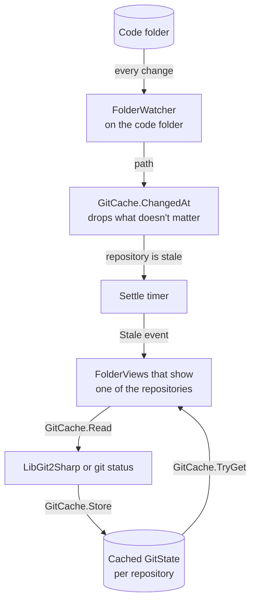
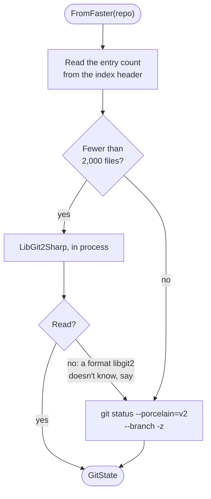
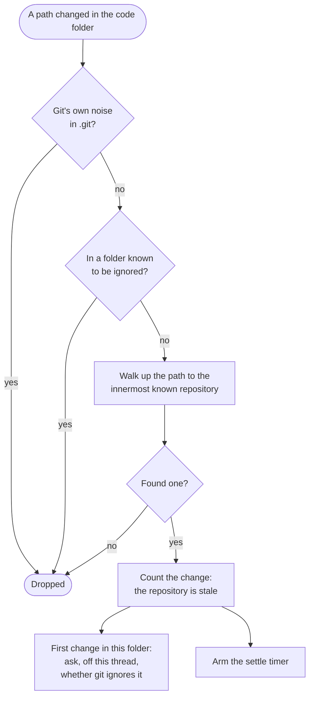
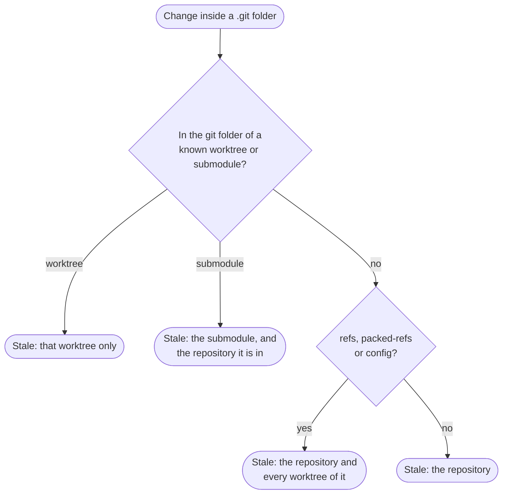
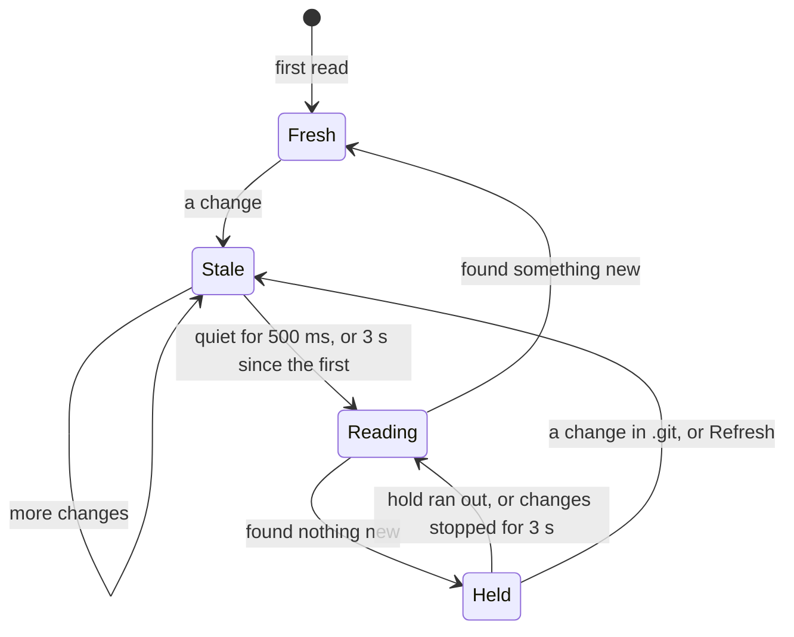
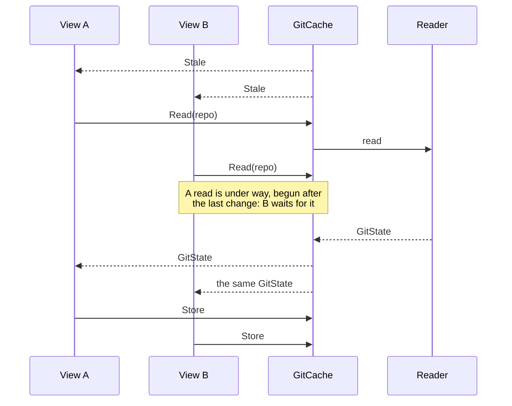

# How Git state is detected

Lode shows the git state of repositories in the code folder: in the **Git** column, and in the status bar of a folder inside a repository. This page explains how that state is read, kept, and brought up to date.

The short version: each repository is read once and cached. One watch on the code folder reports every change in it, and a change in a repository marks it stale. Once its changes have stopped for a moment, the views showing it read it again. Most of the code is about not reading when there is no need to.

| Part | File | What it does |
| --- | --- | --- |
| `GitState` | [src/Lode/Git/GitState.cs](../src/Lode/Git/GitState.cs) | What is known of a repository, and the reader that runs `git status` |
| `LibGitState` | [src/Lode/Git/LibGitState.cs](../src/Lode/Git/LibGitState.cs) | The in-process reader, and which folders git ignores |
| `GitCache` | [src/Lode/Git/GitCache.cs](../src/Lode/Git/GitCache.cs) | The cache, the watch on the code folder, and when a repository is read again |
| `FolderView` | [src/Lode/FolderList/FolderView.cs](../src/Lode/FolderList/FolderView.cs) | Decides which repositories it shows, reads them, and draws the result |

## Overview



## What a state is

`GitState` is a record of:

- the branch, or null when HEAD is detached
- the commit, or null before the first commit
- how many commits it is ahead of and behind the branch it tracks, as of the last fetch
- whether it tracks a branch at all
- the files with changes not yet committed, each with a `GitChange`: Modified, Staged, Added, Renamed, Deleted, Untracked or Conflicted

A folder git doesn't track counts as one file, as `git status` lists it. Ignored files don't count. Two states are equal only when all of this is equal, files included, which the backoff described below relies on.

## Which repositories a view shows

When a `FolderView` loads a folder in the code folder, `FindRepos` works out, on a background thread:

- the repository the folder is in (`containingRepo`), looking up as far as the code folder, or
- when it is in none, which of the folders it lists are repositories (`repos`).

`ReadGitState` then wants the containing repository, plus the listed ones when the Git column is showing. It runs when:

- the folder has been read
- the view becomes visible, or the window comes back to the front
- a git action in the Actions panel finishes
- Refresh (F5) is pressed, which first marks the view's repositories stale
- `GitCache` says one of its repositories has gone stale

For each repository wanted, `ShowCached` asks `GitCache.TryGet`. Whatever is cached is shown at once. Only repositories never read, or not fresh, go on to be read.

## Reading a repository

There are two readers, and `LibGitState.FromFaster` picks between them by the number of entries in the repository's index, read from the 12-byte header of `.git/index`.



- **LibGit2Sharp** saves starting a process, which matters most for small repositories.
- **`git status`** looks over the files on several threads, so it wins on large ones. It runs with `--no-optional-locks`, so it never takes the index lock, and a commit made at the same time doesn't fail on it. `--ignore-submodules=dirty` leaves out what is uncommitted inside a submodule.

For a code folder of 91 repositories, picking per repository took 341 ms, against 590 ms for git alone and 534 ms for LibGit2Sharp alone.

A view reads its repositories in parallel on background threads, in the order they are listed, and shows each as it arrives.

## The cache and the watch

`GitCache` keeps one `Known` entry per repository that a view has asked about. It holds the last `GitState`, the repository's remote site, and a count of the changes seen in it. An entry is **fresh** while that count is the same as when it was last read.

`GitCache.Watch` puts a single `FileSystemWatcher` on the code folder, with subfolders included, so nothing else on the drive is heard of.

Where the code folder can't be watched, on a network share say, or because it isn't there, nothing is ever fresh. Repositories are then read whenever the folder is, and when its tab or window comes back to the front.

### What the watch holds

The watch keeps the code folder open for as long as it is the code folder and Lode is running. Windows treats that as follows:

| Done outside Lode | What happens |
| --- | --- |
| Rename, move or delete something inside the code folder | Works |
| Rename or move a folder the code folder is in | Refused by Windows: the folder is in use |
| Rename or move the code folder itself | Works, but Lode goes on looking for it where it was |
| Delete the code folder | Works. The watch fails, and is started again if the folder comes back |

So choosing a code folder in Options asks first, saying this. Clearing it there, or choosing another, calls `GitCache.LetGo`, which stops the watch at once. Exiting Lode does too.

Lode's own moves, renames and deletes are not affected: `FolderWatcher.LetGo` lets go of every watch at or beneath what is being moved, for as long as that takes.

A code folder that is no longer there when Lode starts is reported in a message before the first window, as `Settings.MissingCodeDirectory` finds it. Nothing then gets a Git menu or column until another is chosen.

## What happens to a change

Every change in the code folder reaches `GitCache.ChangedAt`, on a background thread, so it does as little as it can and allocates nothing.



### Noise in `.git`

Some of what git writes changes no state, so `IsNoise` drops it:

| Path in `.git` | Why it is no change |
| --- | --- |
| `objects/` | An object counts only once a branch or the index names it, and that is a change of its own |
| `logs/` | Only a history of where each branch has been |
| `*.lock` | Taken to write the file beside it, whose change is seen anyway |
| `fsmonitor--daemon/` | Cookie files made and deleted for every status, Lode's own included. Counted, each read would cause the next |

What a state is made of still counts: `index`, `HEAD`, `refs/`, `packed-refs`, `config`, `info/exclude`.

### Folders git ignores

A build writes thousands of files to `bin` and `obj`, none of which change the state. So:

1. The first change in a folder still counts. It also queues the folder to be looked at.
2. On a background task, `LibGitState.Ignored` asks the repository whether git ignores the folder, or a folder it is in.
3. If it does, later changes in it are dropped without the repository going stale.

A folder that is ignored but holds a file git tracks all the same, one added by force say, is not treated as ignored, as a change to that file is a real change.

What was learned of a repository is forgotten, and asked again, when what git ignores may have changed: a `.gitignore` in it changes, or its `index`, `config` or `info/exclude`; on Refresh; and when the watch loses track.

Only folders are learned. A single ignored file in a folder that isn't ignored still counts.

### Worktrees and submodules

A worktree and a submodule have a `.git` *file*, not a folder. Their index and HEAD are in the `.git` of the repository they belong to: `.git/worktrees/<name>` or `.git/modules/<name>`. Left alone, a commit in a worktree would look like a change to the main repository only.

When a repository is first asked about, `GitCache` reads where its git folder really is, and remembers it. A change in `.git` is then routed like this:



- A worktree's index and HEAD are its own alone.
- Branches and config are shared by all worktrees, so each is stale when one moves.
- A submodule's HEAD is also the commit its parent has it at, so the parent is stale too.

This works only where the main repository is in the code folder as well.

## From stale to read again

A stale repository is not read on the spot. A commit, a pull or a build changes many files one after another, and reading means looking at every file. `GitCache` waits for the changes to settle, then raises `Stale` for the views.

- **Settle**: 500 ms after the last change.
- **Longest settle**: no later than 3 seconds after the first change, however long they go on.

One timer serves every repository: it is set for whichever is due first.

A view that isn't looking doesn't wait for the timer. Going to a folder calls `TryGet`, which finds the repository not fresh and reads it straight away.

### Backing off while nothing new is found

Some changes can't be filtered out and go on for a long time, a log file written into the repository say. Reading every 3 seconds would find the same state each time. So when a read of new changes finds exactly the state already cached, the repository is **held**: it counts as fresh, and is not read, for a while. The hold doubles each time, from 3 seconds up to a minute.



With a change every 100 ms for five minutes and nothing new to find, the repository is read at 3, 6, 12, 24, 48, 96, 156, 216 and 276 seconds: 9 reads rather than about 100.

The hold ends early when:

- a read finds something new, after which reads are as close together as at first
- the change is in `.git`: a commit, a stage or a pull is always read once it settles
- the changes stop for 3 seconds, so what a build leaves behind is soon shown
- Refresh is pressed

### Who is told

`Stale` is raised on a background thread with the repositories that are due. Every `FolderView` in every window hears it, but each checks first, on that thread, whether it is showing and whether it lists, or is inside, one of them. Only then does it post to its window's thread and read. A view that can't be seen reads what has gone stale once it shows.

### One read between several views

Two views can show the same repository, the code folder open in two windows say, and both are told of a change. `GitCache.Read` lets the second wait for the first's read rather than do its own.



A read under way is not shared when:

- it began before the last change seen, as it may have missed that change
- the view that owns it let go of it, by going to another folder say, as it may have stopped short

In both cases the second view reads for itself.

`Store` is given the change count from when the read began. If a change arrived during the read, the count has moved on, so what was stored is not fresh and the repository is read again.

## When the watch loses track

The watcher's buffer can overflow when too many changes come at once, and a watch can fail and come back. Either way anything may have changed, so `AllChanged` makes every known repository in that code folder stale, ends every hold, and forgets what was learned of ignored folders.

The views are still told through the settle timer: 500 ms after the last overflow, and no later than 3 seconds after the first. Overflows come again and again while whatever is causing them goes on, and reading every repository shown for each one would add to the load.

## Cost of a change

`GitCacheBenchmarks` in [src/Lode.Benchmarks](../src/Lode.Benchmarks) measures what `ChangedAt` does with one change. None of these allocate.

| Change | Time |
| --- | --- |
| In `.git/objects` | 24 ns |
| To `.git/index` | 167 ns |
| To a source file | 374 ns |
| In an ignored output folder | 481 ns |

Run them with:

```powershell
dotnet run -c Release --project src/Lode.Benchmarks
```

## Limits

- Nothing here applies outside the code folder.
- A code folder that wasn't there when it was first shown is not watched until Lode is restarted, or it is cleared in Options and chosen again.
- A repository is tracked only once a view has asked about it.
- A worktree whose main repository is outside the code folder, or one pointed at another git folder after it was first read, is not followed.
- A single ignored file, in a folder that isn't ignored, still makes its repository stale.
- A change to the index forgets every folder learned for that repository, so each is asked about again.
- Ahead and behind are as of the last fetch: Lode never fetches to work them out.
