#   Lode

[](https://github.com/SimonCropp/Lode/actions/workflows/build.yml)
[](https://www.nuget.org/packages/Lode/)

Alternative to Windows Explorer with a focus on developers.


## Highlights

 * [A right-click menu that opens at once](#right-click-menu), touching no shell extension, with the full Windows menu a click away.
 * [Git on the folder](#code-folder): fetch, pull, push, tag, discard and purge every repository under it, bring in the default branch, merge, squash and merge, or rebase onto another branch, and sync every fork with the repository it was made from, from the right-click menu, the actions bar or the command palette.
 * [The state of each repository and file](#git-state) in a Git column, in changed files' names, and in the status bar, kept current by [fetching in the background](#background-fetch), with [Create pull request](#create-pull-request) (Ctrl+R) for the branch.
 * [Changes and History panes](#changes-and-history) on the right edge, as GitHub Desktop's tabs: pick the files to commit, stash changes and restore them, and see the commits and what each changed, with GitHub Desktop's [diff](#diff), [lines picked to commit](#pick-lines), [lines and hunks discarded](#discard-lines) and all.
 * [Clone](#clone) a repository from GitHub, Azure DevOps or a url, signed in as git signs in.
 * [Coding agents](#coding-agent) and [Claude](#open-in-claude) started in the folder.
 * [Find in Files](#find-in-files), with replace, leaving out what git ignores.
 * [A search box](#search-box) that searches every folder beneath, as quick however much it finds.
 * [Tabs](#tabs), dragged between windows.
 * Has a [command palette](#command-palette).
 * [Undo and redo](#undo) of renames, moves, copies and deletes, across every window.
 * [Stands in for File Explorer](#replacing-file-explorer), so Win+E and folders other apps open land in Lode, and [opens repository links](#repository-links) from GitHub Desktop and Visual Studio.
 * [Installs as a dotnet tool](#install), and says when there is a newer version, which one click installs.


## Install

Lode ships as a [dotnet tool](https://learn.microsoft.com/en-us/dotnet/core/tools/global-tools), [Lode](https://www.nuget.org/packages/Lode). It needs the .NET Desktop Runtime 11 or later.

```
dotnet tool install -g Lode
```


### Updating

Once a day Lode checks nuget.org for a newer version, prereleases included, and says so in the status bar. Click it, or **Update and restart** on the **Updates** page of **Options**: once nothing is running in the Actions panel, Lode closes, runs `dotnet tool update`, and starts again with the windows it had, each where it was with its tabs, the one used last in front. Any other start opens one window, with the tabs of the window closed last. The tray icon's menu has **Update to Lode {version}** too, which asks first while anything is running, as **Exit** does. **Check now**, or **Check for updates** in the tray icon's menu, checks straight away; from the tray, a balloon says what it found. A local build doesn't check.

A newer Lode, in the status bar:


The **Updates** page of **Options**:


## Run

```
lode
lode D:\Code
lode D:\Code\readme.md
```

A folder opens it; a file opens its folder with it selected; nothing reopens the tabs from last time. `lode --help` lists the switches.

From source: `dotnet run --project src/Lode`. Benchmarks: `dotnet run -c Release --project src/Lode.Benchmarks`, with `LodeBenchmarkCode` naming a code folder for the git state benchmark to read.


## Replacing File Explorer

```
lode --replace-explorer
lode --restore-explorer
```

Also buttons on the **File Explorer** page of **Options**. Replacing makes Lode what opens folders and drives, from double-clicks, folder shortcuts and other apps, and what Win+E starts. Restoring puts back whichever app opened folders before.


 * It writes only to `HKEY_CURRENT_USER\Software\Classes`: the current account, no administrator rights.
 * Folders are pointed at the installed tool (`%USERPROFILE%\.dotnet\tools\lode.exe`) whenever it exists, so cleaning a build folder never breaks opening folders.
 * Explorer's own **Open** stays on folders' right-click menus.
 * Apps that ask to *explore* a folder, as Electron apps do (GitHub Desktop's **Show in Explorer**), get Lode too. Folders Lode can't show (Control Panel, the Recycle Bin, libraries) go to Explorer.
 * Apps that show a file selected (a browser's **Show in folder**, VS Code's **Reveal in File Explorer**) get it selected in Lode, in the tab showing its folder, or a new one.
 * The taskbar's File Explorer button, and apps that start `explorer.exe` themselves, still open Explorer.
 * Run `lode --restore-explorer` before uninstalling the tool.


### Going back to File Explorer

 * In Lode: **Options**, **File Explorer**, **Restore File Explorer**.
 * From a terminal: `lode --restore-explorer`.
 * If Lode is uninstalled, or won't start, remove its registry entries by hand:

   ```
   reg delete "HKCU\Software\Classes\Directory\shell\Lode" /f
   reg delete "HKCU\Software\Classes\Drive\shell\Lode" /f
   reg delete "HKCU\Software\Classes\Directory\shell" /ve /f
   reg delete "HKCU\Software\Classes\Drive\shell" /ve /f
   reg delete "HKCU\Software\Classes\Directory\shell\explore" /f
   reg delete "HKCU\Software\Classes\Drive\shell\explore" /f
   reg delete "HKCU\Software\Classes\Folder\shell\explore" /f
   reg delete "HKCU\Software\Classes\CLSID\{52205fd8-5dfb-447d-801a-d0b52f2e83e1}" /f
   ```

   Delete the last four only if Lode added them: each `explore` key, and the CLSID key's `shell\opennewwindow`, has a `CreatedBy` value of `Lode`. If that key's `command` has a `LodePreviousCommand` value, copy it back to the `command` key's default value, and `LodePreviousDelegateExecute` to its `DelegateExecute`, rather than deleting the key. The app that opened folders before Lode is named in the `Lode` key's `LodePreviousDefault` value: read it before deleting the key.

If a folder still opens in Lode afterwards, sign out and back in, or restart Explorer.


## Repository links

On the **Links** page of **Options**, Lode can take over the links code sites use to hand a repository to a desktop app, and open the repository in a tab from the code folder instead:

 * GitHub's **Open with GitHub Desktop** (`x-github-client://openRepo/…`). A file's link selects the file.
 * GitHub's **Open with Visual Studio**, and Azure DevOps' **Clone in Visual Studio** (`git-client://clone?repo=…`).


Each has **Open in Lode**, and **Revert** to give the links back.

 * The repository is found up to two levels into the code folder, by its origin, however its url is written.
 * One not in the code folder can be cloned into it, with the git you have installed, then opened. It goes in a folder named for the repository, or, with that taken, one in a folder named for its owner. A pull request's link checks out its branch, where the repository has it. One with submodules then asks before fetching them, saying where each comes from, as a link from a web page could point anywhere: fetched, they are checked out, as `git submodule update --init --recursive` does; left out, their folders stay empty. One that can't be fetched says why, and the clone opens all the same. Or the link can go to the app it was for.
 * The app's other links, GitHub Desktop's sign-in say, go straight to it, as Windows would have handed them on. A link handed on reaches the app exactly as it came, as one argument, whatever it holds.
 * It writes only to `HKEY_CURRENT_USER\Software\Classes`, keeping what was there for Revert.
 * GitHub Desktop may take its links back when it updates: the **Links** page then says so.


## Features

 * **Address bar**: each folder up the path is a button, as in Explorer: click one to go there, middle-click or Ctrl+click it to open it in a new tab, or right-click it to **Copy address** or **Open in new tab**. Click the chevron after a folder to drop down the folders in it, hidden ones and Windows' own as the options show them, and, where the bar is too narrow for the whole path, the **…** at its start to drop down the folders it stands for, the nearest first; pick one to go there, with the mouse or the arrow keys and Enter, or press Escape to close the list. Click the empty space after the path, or press Ctrl+L, to type: a path, full or from the folder open (`src`, `..`); a shell name, `shell:downloads`; or a command, `cmd`, `wt` or `code .`, run in the folder open.
 * **Actions bar**: a button for any of the right-click menus' actions, enabled when it applies to the selection. On the **Button actions** page of Options, choose which actions are buttons, and which are nested under their parent (Clipboard, File, Open, Terminal, AI, Git, Packages) in a drop-down button; on the **Menu actions** page, which are in the right-click menus, and which are nested under their parent in a submenu. The rest are under **See more** (⋯), as are the buttons a narrow window has no room for. Right-click a button to hide it, which puts it under See more, or nest it under its parent; right-click a parent's drop-down to hide it, or un-nest what is in it, all of it or one; right-click an action in the drop-down to hide or un-nest just that one. **Customize buttons…**, on the same menu, opens the Button actions page.

   Right-clicking the **Git** drop-down:

   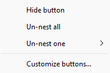

   **See more**, with the actions that aren't buttons:

   

   The **Button actions** page of **Options**:

   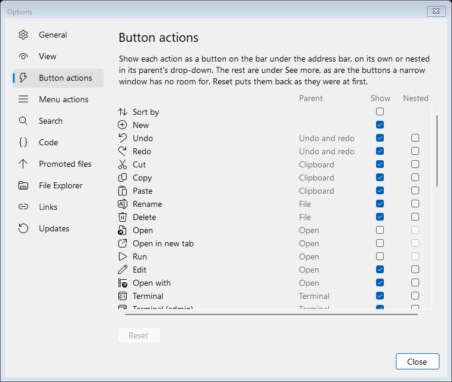

 * <a id="tabs"></a>**Tabs**, each with its own history: right-click **Back** or **Forward** for where it goes, to go several steps at once, and a folder deleted since is passed over. Right-click one to duplicate, pin or close it, or the others. **Reopen closed tab** (Ctrl+Shift+T) brings back the last closed. A tab follows its folder when it is renamed or moved, and goes up when it is deleted. Drag a tab along the row to reorder it, off the row for a window of its own, or onto another window to move it there. **Close tabs not looked at for**, on the **General** page of Options, closes tabs unused for the hours given.

   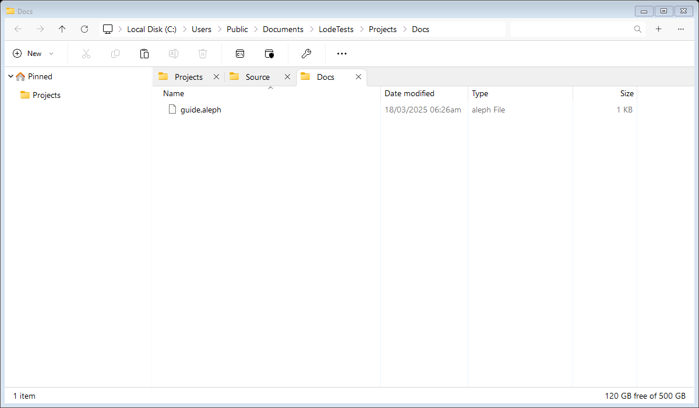

 * <a id="command-palette"></a>**Command palette** (Ctrl+Shift+P): type part of a command's name and press Enter. It has the window's commands and what the right-click menu offers for the selection.

   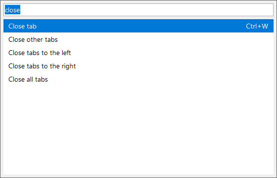

 * **The tray**: closing the last window hides it there. Click the tray icon, or launch Lode, to bring it back; Shift+click for a new window. **Exit** quits, asking first while anything is running.
 * **One copy per account**: launching Lode again hands its folders to the running copy, in a new tab, or the tab already showing the folder. Lode run as administrator is a copy of its own, beside the one that isn't, with its own window size and tabs, and the same options: what either changes the other has the next time it starts.
 * **Jump list**: right-click Lode on the taskbar for the folders pinned to Quick access, and those used often.
 * **Folder tree**: **Pinned** (Quick access, as in Explorer), **Recent**, This PC with the drives, and **Network**, with the machines of folders pinned or gone to, each listing what it shares, and the shares of folders pinned or gone to that it doesn't list: an administrative share such as `c$`, or any on a machine that won't say what it shares. WSL's, `\\wsl.localhost`, shares the Linux distributions installed. Pinned and Recent are read from Quick access again on F5, when a window comes back to the front a few minutes after they were last read, and when Lode moves, renames or deletes one of them, so a folder pinned in Explorer or a file dialog shows too. Drives come and go as they are plugged in or mapped. The tree follows the tab to the open folder, unless **Expand the folder tree to the open folder** is off on the **View** page. To pin a folder, drag it or its tab into **Pinned**, or right-click it; drag a pin, or press Alt+Shift+Up and Down, to reorder. Folders in the tree have the list's right-click menu and keys. On the network, **Show more options** and **Properties** wait for the machine to answer without holding up any window, and say it can't be reached if it doesn't within a few seconds. **This PC**'s menu is Explorer's: Manage, Map network drive and the rest.

   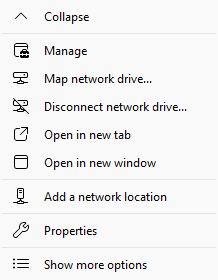

 * **The list**: details with shell icons and types, natural sort, each folder keeping its own sort. Date modified sorts newest first, as Explorer's does, and the other way when clicked again. What is cut shows dimmed. Drag from the margin left of the list to select. Opening more than 15 items at once, with Ctrl+A and Enter say, asks first, as Explorer does. Right-click a column header to size columns to fit, or show or hide them, in every tab. **Sort by**, first on the right-click menu where nothing is clicked, under See more, and in the command palette, sorts by any column, a hidden one too: that one then shows for as long as the list is sorted by it, so Date modified can stay hidden until it is sorted by.

   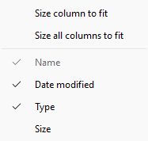

 * <a id="large-icons"></a>**Large icons**: each item's thumbnail, a picture's, a video's or a document's, where the shell can make one, or else its icon, big, with its name under it. Ctrl+Shift+2, or Ctrl and the mouse wheel turned away, as in Explorer; **Details** (Ctrl+Shift+6, or the wheel turned back) is the columns again. Both are on the ⋯ menu. Each folder keeps the view it was last shown in, in every tab and the next time Lode starts, as Explorer's do. Thumbnails are read in the background, only for what is on screen, and kept while the folder is open. A changed file's letter is at the foot of its picture. Selecting, renaming, dragging and the keys work as in Details; the columns, the Git column's state of each repository among them, and dragging a selection rectangle from the margin, are Details' alone.

   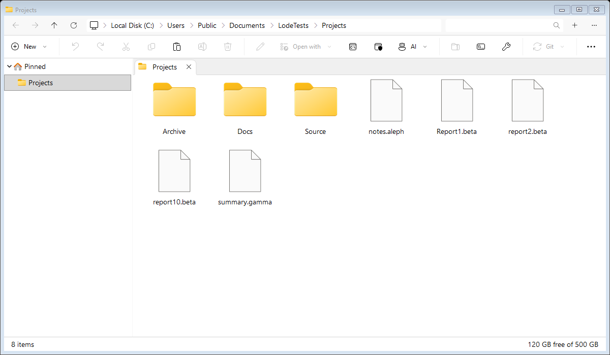

 * <a id="promoted-files"></a>**Promoted files**: at a git repository's root, the files just below it that you name, `src\Lode.slnx` or `src\Directory.Build.props` say, are listed there too, as shortcuts with the arrow, so they open without going into `src`. Name them on the **Promoted files** page of Options, one a line: a whole name, or one with a `*`, before which is how the name starts and after which how it ends (`*.slnx`, `Directory.*.props`). They open, edit, copy and drag as the file itself, but Rename, Cut and Delete aren't offered on them at the root. Only the folders just below the root are looked in, and nothing is written to the repository.

   The **Promoted files** page of **Options**:

   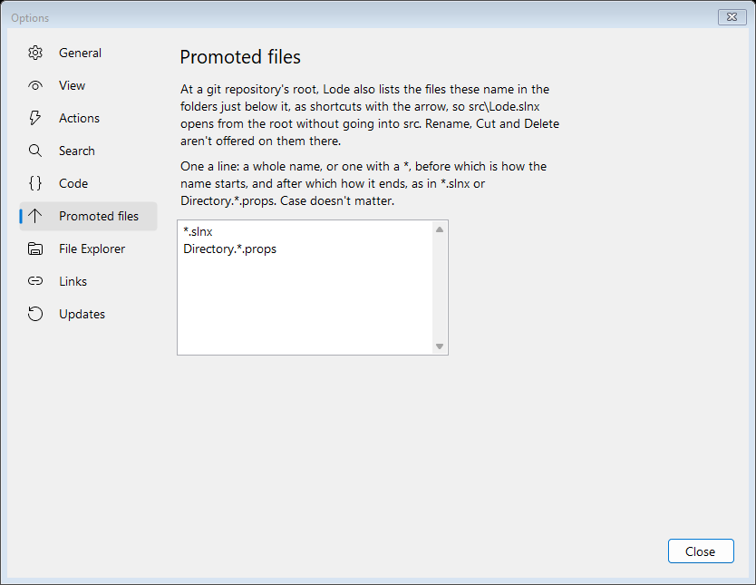

 * <a id="right-click-menu"></a>**A right-click menu that opens at once**: Open, Terminal, Terminal (admin), Cut, Copy, Rename, Delete, Create shortcut, Copy as path, Properties and so on. **Open with** lists the apps Windows recommends. **New** on empty space makes a folder, or a file of a type Windows offers. **Show more options**, or Shift+right-click, opens the classic Windows menu, with installed shell extensions; its Delete, Create shortcut and New are done by Lode, so Ctrl+Z undoes them.

   The right-click menu on a folder:

   

   **New**, on empty space:

   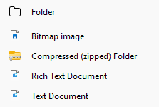

   The **Menu actions** page of **Options**, for which actions the menus offer:

   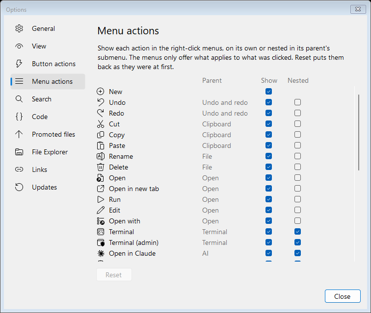

 * **Options**, in the ⋯ menu. Changes apply straight away.
   * **General**: the folder new tabs open in, the text editor, closing unused tabs.
   * **View**: the theme (light, dark, or as Windows, taken on at the next start), hidden items (also Ctrl+H), system files, expanding the tree to the open folder, the Recent section.
   * **Button actions**: the bar's buttons, and **Reset** to put them back as they were at first.
   * **Menu actions**: the right-click menus' entries, and **Reset** to put them back as they were at first.
   * **Search**: whether the search box searches what git ignores, Find in Files' context lines, and turning Windows Search off, or on again, which Lode doesn't use.
   * **Code**: the code folder, what Git purge keeps and how it deletes, excluding the code folder from Defender.
   * **Promoted files**: [the files just below a repository's root listed there too](#promoted-files).
   * **File Explorer**: replace it, or restore it.
   * **Links**: [Repository links](#repository-links).

   The ⋯ menu:

   

   The **General** page of **Options**:

   

   The **View** page of **Options**:

   

 * **Edit**, on text files, opens them in the editor chosen in Options: VS Code, Notepad++ and others are found; Notepad is always there.
 * **Run**, on PowerShell scripts, runs each in a Windows Terminal tab in its folder, by PowerShell 7 where it is installed.
 * <a id="open-in-claude"></a>**Open in Claude** starts a Claude Code session in the folder, in the [Claude desktop app](https://claude.com/download), when it is installed.
 * <a id="coding-agent"></a>**Coding agent** starts an installed coding agent in a Windows Terminal tab in the folder: [Claude Code](https://code.claude.com), [GitHub Copilot CLI](https://github.com/github/copilot-cli), [Codex CLI](https://github.com/openai/codex) or [Gemini CLI](https://github.com/google-gemini/gemini-cli).
 * <a id="code-folder"></a>**Code folder**: choose the folder your git repositories are in, on the **Code** page of Options. Lode watches it while it runs, so Windows won't let a folder it is in be renamed or moved: **Clear** it first, or exit Lode. **Exclude from Defender…** stops Defender scanning it, which speeds up builds and git. Folders in it get a **Git** submenu and **Update NuGets** (and with a build), on the repository the folder is in, or every repository up to two levels down, six at a time, a repository and its worktrees one after another, as they share one set of branches:
   * **Fetch**, **Pull**, **Push**, **Discard**, as git does them. Push commits every change first, new files included but not what git ignores, nor a repository of its own inside that git doesn't track, a clone or a worktree say, which git would commit only as a link to its commit, asking for the message and saying how many new files go in, and which repositories inside it leaves out, but not where files are still in conflict, or no branch is checked out: that repository is left, and says why, and what to do: settle the conflicts in [Changes](#conflicts), or abort the merge there. A branch tracking none, as one made here, Push publishes, as GitHub Desktop does: to a branch of its name on origin, which it tracks from then on. Discard puts back every uncommitted change, staged ones too, and deletes new files, though not what git ignores, nor a repository of its own inside, the files as they were going to the Recycle Bin first, as Changes' discard sends them; on a folder inside a repository, only what is in that folder, as Purge purges only it. Push, Discard and Purge ask first. Push isn't offered with nothing to push, nor Discard with nothing uncommitted. On a folder holding repositories, Push looks in them all at once before it asks, and leaves those already known to have nothing to push, rather than going to origin for nothing. A pull that would conflict, merging or rebasing as your git config says, is undone, saying which files would, so no repository is left part way through one; nor does Pull go into one part way through a merge or rebase already. Cancelling a pull stops its fetch, but a merge or rebase it has begun is left to finish, so none is left part way, the repository locked. Git is never left waiting on an editor nobody would see: an interactive rebase, as `pull.rebase=interactive` asks for, fails at once, changing nothing. Nor on ssh asking for a key's passphrase, from any git, the ssh an LFS filter runs for a switch or a merge among them: it fails instead, unless your git config has an ssh command of its own, `core.sshCommand`, which is left to ask as it does. In a fork, Fetch learns what upstream has too. Fetch prunes, as `git fetch --prune` does: a branch deleted on origin, merged and deleted on its site say, goes from the branches here, rather than staying as `origin/x`.
   * <a id="sync-fork"></a>**Sync fork**, in a fork: a repository with an `upstream` remote, the repository it was made from, as GitHub Desktop sets one up. It does what GitHub Desktop's **Fetch origin**, **Update from upstream** and **Push origin** do, one after another: fetches origin and upstream, brings in what origin has that the branch hasn't, merges upstream's default branch into the branch checked out, and pushes the branch to origin, publishing one tracking none as Push does. A branch with commits of its own gets a merge commit. A merge that would conflict is undone, and nothing is pushed, as is a branch that has diverged from origin, or one part way through a merge or rebase already. On a folder holding repositories, it syncs only the forks.
   * **Switch to default branch**, origin's, unless anything is uncommitted. Not offered when already on it.
   * **Update from default branch**, as GitHub Desktop's: fetches, and merges origin's default branch into the branch checked out, or in a fork, upstream's. Nothing is pushed. Not offered when already on the default branch, which Pull brings up to date.
   * <a id="merge"></a>**Merge into current branch**, **Squash and merge into current branch** and **Rebase current branch**, as GitHub Desktop's: pick a branch, filtering them by name, and it says what it would do, as GitHub Desktop says it (`This will merge 3 commits from feature into main`), or that there is nothing to. A merge that would conflict is found before it begins, as git would merge it, without touching the folder, and the files that would conflict listed; merged, it is left part way, and [Changes](#conflicts) slides out to settle them. A squash commits the branch's commits as one, with git's message listing them; one that would conflict can't be squashed here. A rebase that rewrites commits origin has says so, and offers to force push afterwards, overwriting origin's branch only where the branch has every commit on it, so nothing anyone else pushed is lost: with commits fetched but not pulled, force push isn't offered, and pull first is. A squash that conflicts after all is undone, saying which files, as is a rebase that conflicts. Each needs nothing uncommitted but new files, and is for one repository at a time. Right-click a branch in the status bar's branches to merge it, squash and merge it, rebase onto it, or compare with it.

     Merge into current branch, a branch picked:

     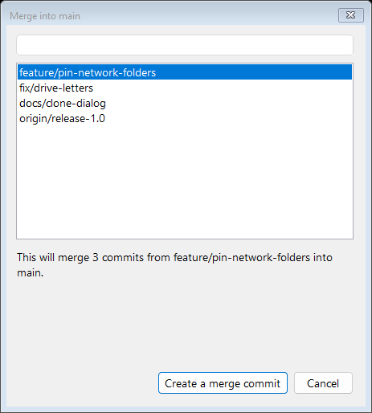

     Rebase current branch, rewriting commits origin has, so offering to force push:

     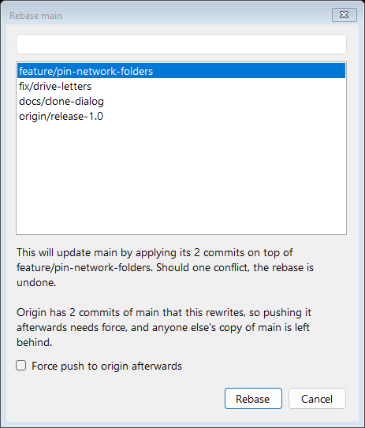

     A branch right-clicked in the status bar's branches:

     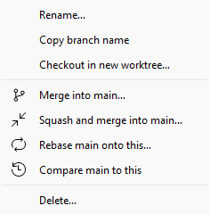

   * **Tag** tags the commit checked out and pushes the tag to origin, offering the one after the latest, 2.0.1 after 2.0.0. The tag is annotated, its name its message, and signed where your git config says, `tag.gpgSign`. Commits not yet pushed go with it, in the one push, so origin's branch has the commit tagged, and a branch origin hasn't got goes too; both go or neither does. Uncommitted changes aren't in the tag unless **Commit the changes first** is ticked, with a message, as Push commits them. A branch diverged from origin's is left, to be pulled first. Detached, the tag goes alone. Offered only for repositories, not a folder holding them. Deleting a tag is History's.
   * **Purge** deletes everything git doesn't track, ignored files included (`git clean -xdf`), to the Recycle Bin, unless Options says permanently, but for what Options keeps, patterns as in `.gitignore`, passed to `git clean` as `-e`: at first `.env`, `.env.*`, `.vs/`, `.idea/` and `*.user`, secrets and what IDEs keep for you, which no build makes again. It asks once it knows how many items, and how big, naming the first of them, what isn't build output (`bin`, `obj`, `node_modules` and the like) before what is, and what it keeps.
   * Each runs in the **Actions** panel under the tree, with progress. Click a line for what it reported; right-click to cancel or remove it. Cancelled, it says what it did till then; a Cancel that comes as it finishes, too late to stop anything, leaves it as it went. A line that went well leaves after a minute; one that failed stays, as does a deleted branch's, which says the commit the branch was at.
   * <a id="git-state"></a>**Git state**: a **Git** column says of each repository its branch, changes, and commits ahead and behind (`main · 3 changes · 2 ahead`), in a fork how far behind upstream it is (`main · 12 behind upstream`). In a repository, each changed file's name is in the colour for what has become of it, with its letter after it, M for Modified say, and each folder holding changes has how many after its name, as an editor marks them; the Git column, which would say it again, shows there only once shown from the column headers' right-click menu. Beside it, a **Tag** column says of each repository its most recent tag, the nearest back from the commit checked out, as `git describe --tags` finds it. The status bar says it of the repository, links to its page on GitHub, Azure DevOps, GitLab or Bitbucket, and acts on it when clicked: behind offers Pull, ahead Push, changes Commit and push or Discard, and Abort merge part way through one, behind upstream Sync fork. Each repository is read once and again only when something in it changes, so going back to a folder reads nothing. F5 reads them all again. How it works: [docs/git-status.md](docs/git-status.md).
   * <a id="background-fetch"></a>**Fetching in the background**: ahead and behind are as of the last fetch, so the repositories open in tabs are fetched as GitHub Desktop fetches them, each an hour after it was last fetched, by Lode or by git anywhere else, as git's `FETCH_HEAD` says, and the status bar and the Git column follow. Quietly: nothing in the Actions panel, and no dialog when one fails, offline say, which is tried again an hour later. It never asks for a password, nor lets Git Credential Manager show its window to sign in: where git would have to ask, it fails, and Fetch, from the Git menu, asks as git does. Never two at once for one repository, a repository and its worktrees being one, nor while anything in the Actions panel, a pull say, runs on it. Only those of windows showing, not those gone to the tray. On the **Code** page of Options: on or off, and how many minutes apart.
   * <a id="create-pull-request"></a>**Create pull request** (Ctrl+R), as GitHub Desktop's: right-click the branch in the status bar, where it also copies its name and views it on GitHub, Azure DevOps, GitLab or Bitbucket, or find it in the ⋯ menu and the command palette. It opens the site's page that creates one from the branch, GitLab's a merge request: offered where the branch tracks one of origin's that is there still, as View on is, by its name there. A branch tracking none isn't on origin yet, so it asks to push it first, publishing it as Push does, and opens the page once it is there. A branch tracking one gone from origin, one of the repository's own, or another remote's, has none on origin to make one from, which Ctrl+R says.
   * **Switch branch**: click the branch in the status bar, or press Ctrl+B, for the repository's branches, as GitHub Desktop lists them. Type to filter; Enter switches. Uncommitted changes can be left on the branch, stashed, or brought along; those left wait in [Stashed changes](#stashes). Should git stash them but not clear them from the folder, over a file another program has open, nothing is switched, and the changes are as they were, with no stash left over. It also makes, renames and deletes branches, copies a branch's name, and checks one out in a new worktree.
   * <a id="changes-and-history"></a>**Changes and History**: inside a repository, the two panes go where the window has room for them. With room beside the list for both, they are side by side, Changes then History. With room for one, they share it as tabs along its top; click a tab to show its pane, and the one showing, or the one used last, is kept for each repository. With room for neither, a strip down the window's right edge has a tab for each, with its icon: hover one and its pane slides out over the list, sliding back once the pointer leaves it and the focus isn't in it; click it to open it with the focus in it. Right-click the strip to write the names down it (Vertical names), across under the icons (Horizontal names), or not at all (Icons only); without the names down it, how many files have changed shows in a badge beside Changes' icon. Ctrl+Shift+G (Changes) and Ctrl+Shift+H (History) put the focus in a pane, choosing its tab or sliding it out, and again give it back to the list.
     * **Changes** lists what is uncommitted, each file on its own, ticked to go in the commit. The funnel beside how many have changed shows a filter, to list only the files whose names match; Escape, or the funnel again, puts it away. Type a summary, and a description if you like, from the button beside the summary, which stays shown while it holds something, and **Commit to** the branch (Ctrl+Enter): only the ticked files go in, and what else is staged stays staged. Once it is in, the summary and description are cleared, but for one typed over while it was under way, held by a slow hook say, the next message begun, which is kept; a commit under way holds back Commit in its own repository only. Part way through a merge, or a revert, everything is committed, and the summary starts as the first line of git's message for it and the description as the rest, a revert's `This reverts commit` or the commits merged in as `merge.log` lists them, less the lines git comments out, so the commit keeps the whole message. <a id="conflicts"></a>Left part way by conflicts, as GitHub Desktop's, a bar over the files says what is merging into what and how many files are left, with **Abort merge**, which puts the branch and its files back as they were. Each file in conflict says how many conflicts are marked in it, **No conflicts left** once its markers are gone, settled in the editor, or **Pick a side** for one a side deleted, or that isn't text. Right-click one to **Use the file from** the branch checked out, or the branch merged in, whole, or the deletion where that side deleted it, or to **Mark as resolved** as it is, once no markers are left in it. **Commit merge** waits till none are left. A rebase stopped by conflicts, by `git pull --rebase` or `git rebase` in a terminal say, has the bar too, saying what is being rebased onto what, with **Continue rebase** and **Abort rebase**. Its sides are named as GitHub Desktop names them, **Use the file from** what it goes onto, or from the branch being rebased, whose commit is being replayed, and **Continue rebase**, which Commit is then too, waits till none are left, puts the files git tracks in that commit, with its own message, and goes on with the rebase; files git doesn't track stay out of it. A cherry-pick stopped by conflicts, History's or a terminal's, has the bar too, saying which commit is being cherry-picked onto which branch, with **Continue cherry-pick** and **Abort cherry-pick**: its sides are the branch checked out and the commit, and **Continue cherry-pick**, which Commit is then too, waits till none are left, and makes the commit with its own message and author, of what it changed and the files that were in conflict as settled; any other change stays uncommitted. Pick a file for its [diff](#diff); double-click it for its changes in the text editor, when it is VS Code or one made from it, or in git's diff tool when one is set. Right-click to discard the changes, the files as they were going to the Recycle Bin first, **Stash all changes**, new files included, with a message, open it, show it in its folder, copy its path, or have git ignore it. <a id="stashes"></a>**Stashed changes**, under the files, lists the repository's stashes, newest first, those left on a branch switched off and any made in a terminal, each with the branch it was made on and when; click it to show them. Right-click one to **Restore** it, its changes put back, new files too, and the stash dropped, or **Discard** it, having asked, as that can't be undone. A stash that clashes with what is there now is kept, and its clashes are files in conflict, to settle as a merge's are, **Use the file from** the branch or the stash; one git refuses to restore, over changes it would overwrite, changes nothing, and is kept too. Neither stashing nor restoring is offered part way through a merge or rebase, or with conflicts left. Hover a file's icon for what happened to it, or its row for its whole path. With nothing uncommitted, it says so in place of the files, and suggests what to do next, the commits to pull or push, or, in a fork, to sync, each button asking first as the status bar does. Where git can't read what is uncommitted, refusing a repository owned by another user say, as it does one on exFAT or a share until it is a `safe.directory`, what git said shows there instead, with nothing to commit, and the files read last, and their ticks, are kept for when it can again. Ticks and what is typed are kept for each repository while Lode runs.

       A merge left part way by conflicts:

       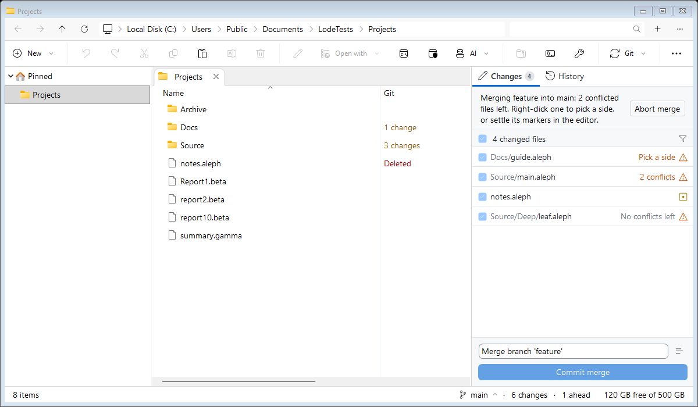

     * **History** lists the branch's commits, newest first: subject, author, how long ago, tags, and an arrow for those not pushed, each tag and arrow saying what it is when hovered. Pick one for the files it changed, a merge's against its first parent, and click it again to put them away; pick a file for its [diff](#diff), or double-click it for its changes in the text editor. **Compare to branch…**, in the ⋯ menu and the command palette, or on a branch right-clicked in the status bar's branches, lists instead the commits another branch has that the one checked out hasn't, **Behind**, and those it has that the other hasn't, **Ahead**, with how many each way, and from Behind merges them in; × goes back to the branch's own. Right-click a commit to copy its SHA or message, make a branch at it and switch to it (**Create branch from commit**), check it out on no branch (**Checkout commit**), tag it, or delete one of its tags, from origin too, or view it on GitHub, Azure DevOps, GitLab or Bitbucket. Comparing, a commit behind, which the branch checked out hasn't got, can be made again on it, with its message and author (**Cherry-pick onto** the branch); one that conflicts is left part way, for Changes to settle and continue, or abort.

     Changes and History side by side, with room for both:

     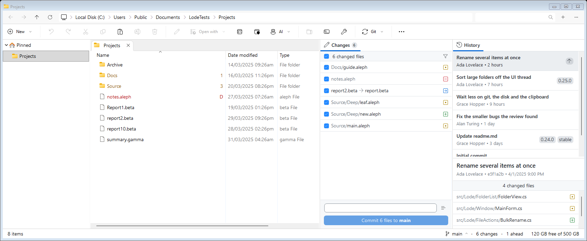

     As tabs, with room for one, History chosen:

     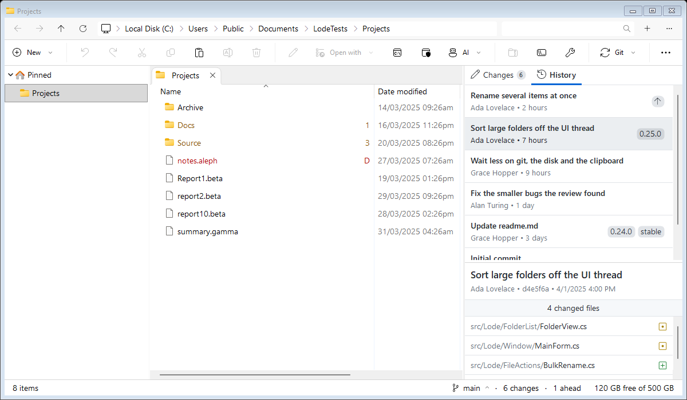

     Changes slid out from the strip, with room for neither:

     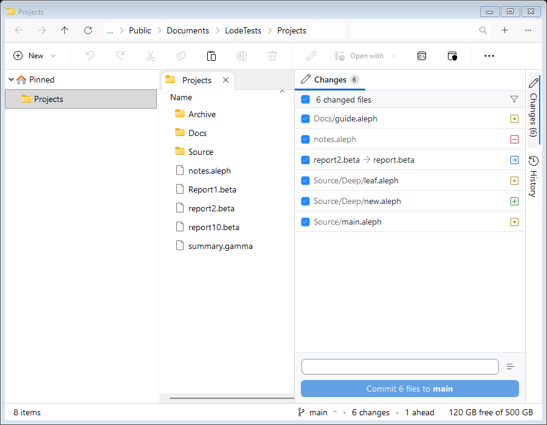

     History comparing the branch with develop:

     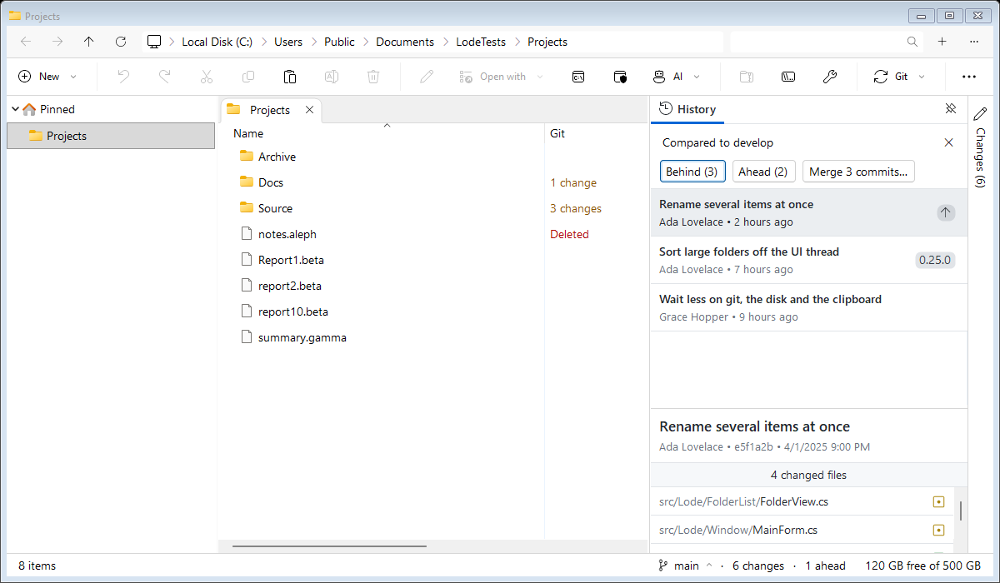

   * <a id="diff"></a>**Diff**: pick a file in Changes or History for its changes, drawn as GitHub Desktop draws them, from git's own diff. They show in a **Diff** tab beside the folders' tabs, the panes staying beside it, or, as **Changes** on the **General** page of **Options** says, over the folder list (Esc or the × puts it away), in a window of their own with the files changed down its left, or in the text editor as before. Double-click a file, or press Enter, for the text editor, or for the window where changes show in one.
     * One above the other, the old and new line numbers side by side, or the old file beside the new, and **Hide whitespace changes**, from the button along its top, kept for every diff. Where a run of changes deletes as many lines as it adds, the part of each line that changed is darker, as on github.com.
     * The arrows in a hunk's heading show 20 more lines of the file above or below it, or all of a short gap at once. Right-click for **Expand whole file** or **Collapse expanded lines**.
     * A picture shows as it was beside as it is. A binary file, an empty one, one only renamed, and a diff too big to show straight away say so, the last with **Show diff**.
     * <a id="pick-lines"></a>**Pick lines to commit**: in an uncommitted change, click a line's numbers, or drag down them, to leave it out of the commit or put it back; the strip beside the numbers does a run of changes at once. The file's tick shows a dash while only some of its lines go in, and Commit takes only those: the rest stay changed, and whatever else was staged stays staged. Lines aren't picked with whitespace hidden, part way through a merge, or in a renamed file, which goes in whole. Should the file change after its lines were picked, nothing is committed, and it is ticked whole again.
     * <a id="discard-lines"></a>**Discard lines**: in an uncommitted change, right-click a line added or deleted for **Discard line**, or one of the lines selected to discard them all, or anywhere in a hunk for **Discard hunk**, as GitHub Desktop has them: a line added goes, and a line deleted comes back, in the file on disk alone, whatever is staged staying staged. It asks first, and the file as it is goes to the Recycle Bin before, so it can be got back. Lines left out of the commit stay left out. Not offered with whitespace hidden, part way through a merge, or in a file new, deleted, renamed or in conflict, which **Discard changes** in Changes puts back whole. Should the file have changed since its diff showed, nothing is discarded.
     * Rows clicked copy with Ctrl+C.

     The Diff tab, Changes beside it:

     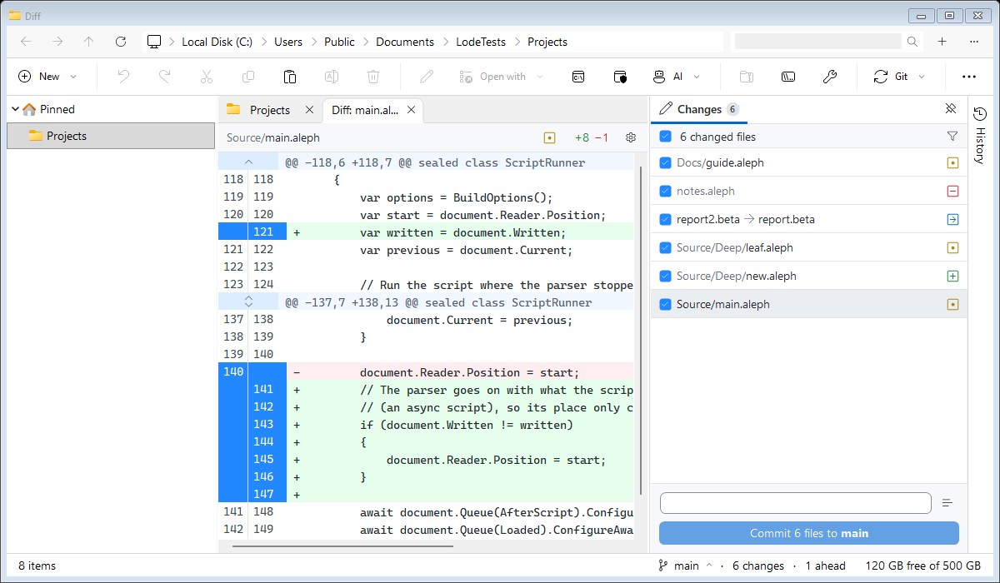

     The old file beside the new:

     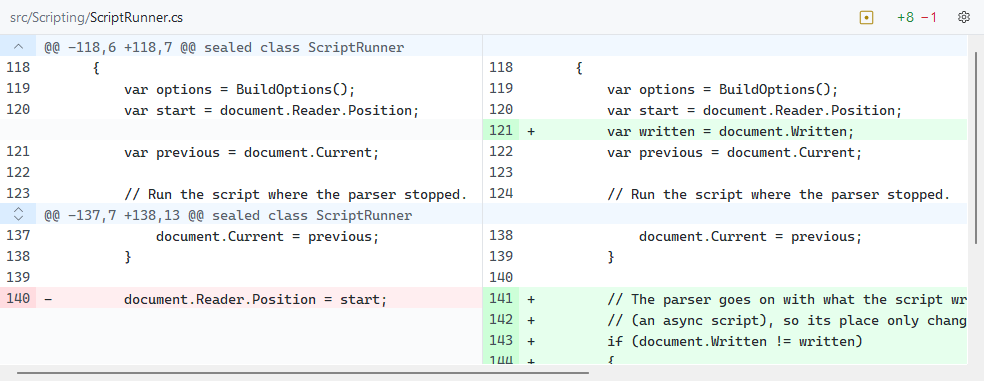

     A commit's changes in a window of their own:

     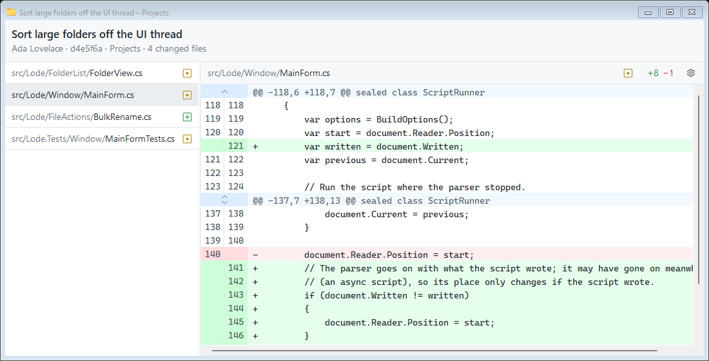

   * <a id="clone"></a>**Clone** (Ctrl+Shift+O, or **Clone a repository…** in the ⋯ menu), as GitHub Desktop's: **GitHub** and **Azure DevOps** list the repositories you can clone, those already in the code folder left out, and a filter narrows them; **URL** takes any url, or a GitHub repository's `owner/name`; a page of a repository on GitHub, Bitbucket or Azure DevOps, pasted from the browser, a branch's files or a pull request say, clones the repository. It signs in with the credential git uses for the site, from Git Credential Manager or `gh auth login`, so Lode keeps no token; Git Credential Manager may ask you to sign in the first time. As git does, it tells git how the credential went: one the site took is kept, so the clone, and Lode next time, sign in with it rather than asking again, and one the site refused, a token since revoked say, is dropped, so the next asks you to sign in again. Azure DevOps lists the organizations the code folder has clones from, any you add, and the others your account belongs to. The clone goes in a folder named for the repository in the code folder, which you can change, runs in the Actions panel, and opens in a tab. Its submodules come too, and theirs in turn, checked out as `git submodule update --init --recursive` does, so it builds, as GitHub Desktop's clone does; git takes their urls as it would in a terminal, refusing a `file://` one unless your config allows it, as `protocol.file.allow` does. One that can't be fetched fails the clone in the Actions panel, saying why, but the clone stays, and opens. So does one cancelled once it is cloned, as its upstream is set up or its submodules come: the Actions panel says Cancelled, and what was left undone. A fork on GitHub gets the repository it was made from as its `upstream` remote, with its default branch recorded, as GitHub Desktop sets one up, ready for [Sync fork](#sync-fork); GitHub is asked with the credential git keeps, never showing a window to sign in, and without one where there is none.

     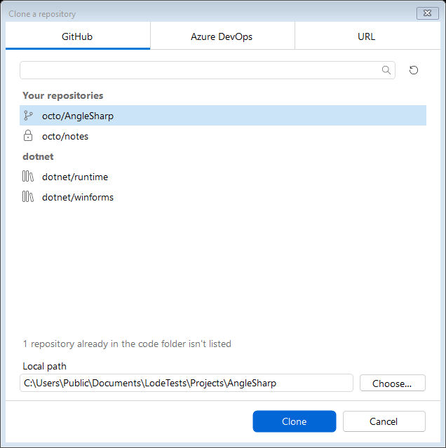

   * **Rider keeps asking** to exclude each project from Defender, as it can't see the code folder is excluded. Turn its notification off for all projects, from **More** on it.

   The **Code** page of **Options**:

   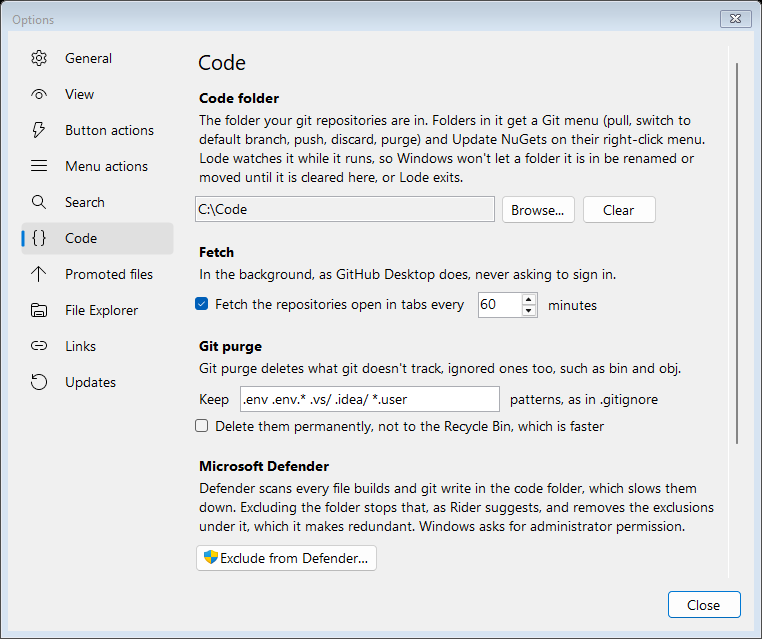

   The **Actions** panel, with one action running, one that failed and one done:

   

 * **Copy, move, delete and rename** go through the Windows shell, as Explorer's do, with its progress, conflict prompts and Recycle Bin. What is pasted is selected. With several selected, the name typed for one is given to them all, numbered: `Plan (1).txt`, `Plan (2).md`.
 * <a id="undo"></a>**Undo** (Ctrl+Z) and **Redo** (Ctrl+Y), across every window: renames, moves, copies, deletes to the Recycle Bin, and new items. Permanent deletes can't be undone.
 * **Drag and drop**, with Explorer and other apps. The folder a drag would drop into is highlighted. In the tree, a folder held over opens, and the tree scrolls at its edges. Drag with the right button to choose Copy here, Move here or Create shortcuts here.
 * **Zips**: **Compress to ZIP file**, **Extract All** and **Extract here**, in the Actions panel, undoable. Double-click a zip to go into it as a folder, without changing it; what is opened, copied or dragged from it is extracted first, in the background. A drag starts once what it carries is out, with the button still held, the status bar saying how far it has got; let go, or press Esc, before then to stop it.
 * <a id="search-box"></a>**Search box**: type part of a name, or `*.csproj`. The folder's matches show at once, then those in every folder beneath, with a **Folder** column. What Lode renames, moves or deletes among them shows as it now is, and goes where it no longer matches. A new folder or file, a paste or an extract that it doesn't match clears it, so what was made shows, selected. In a repository it leaves out what git ignores, and `.git`. It stops at 100,000. **Search inside the files**, or Ctrl+Enter, searches with Find in Files instead.

   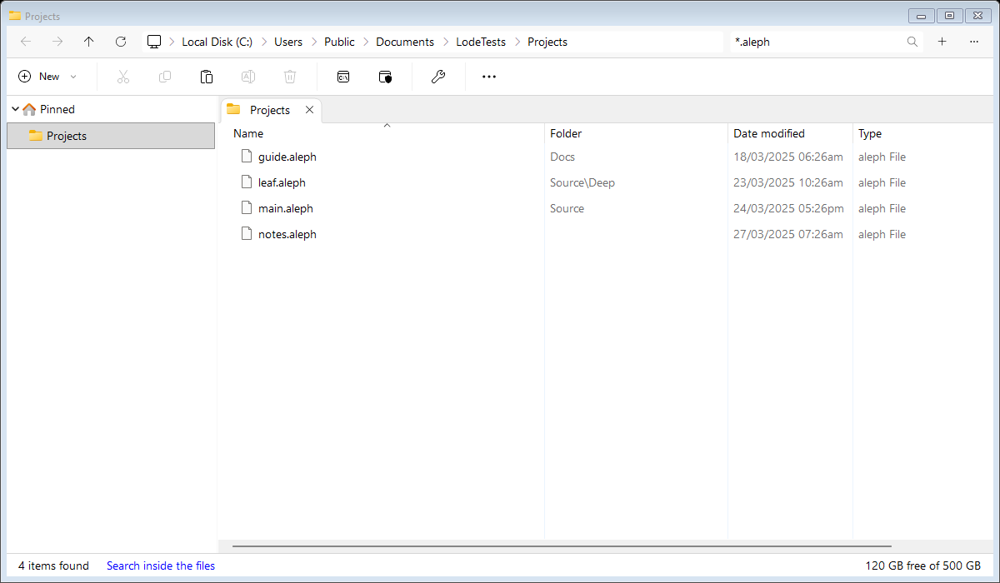

 * <a id="find-in-files"></a>**Find in Files** (Ctrl+Shift+F) searches what files hold, reading every file, so nothing needs indexing. In its strip along the bottom:
   * **Find**: text, or a regular expression (**.\***), case (**Aa**) and whole word (**ab**) as wanted.
   * **Where**: folders and files, `<open folders>`, and patterns: `*.cs` to include, `-*.min.js` or `-node_modules\` to exclude, `**\` for any number of folders, none among them (`src\**\*.cs`), and braces for alternatives (`*.{ts,tsx}`). A folder with a comma in its name goes in quotes.
   * In a repository only what git doesn't ignore is searched, unless **Git-ignored** is on. `.git` never is, nor binary files.
   * **Find Results** opens in a tab: each file's matching lines, with context. Enter opens the file in the editor at the line; F4 and Shift+F4 go through the matches.
   * **Replace** replaces in every file found, asking first, keeping each file's encoding and line endings, and can be undone.

   

 * **The list refreshes itself** when the folder changes on disk. Lode lets go of a drive while Windows removes it, so it never blocks **Safely remove**.
 * **A shell extension that stops answering** is cut off after 3 seconds, and skipped for the session.
 * **Settings** are kept in `%AppData%\Lode\settings.json`: window size, tabs and options, which of Changes and History shows for each repository, how the strip labels them, where diffs show and how, and the Azure DevOps organizations added in Clone. The tabs are saved as they change, those of the window used last, so they come back after a crash too. Each save is on the disk before it takes the file's place, and the file it replaces is kept as `settings.backup.json`, which Lode starts with, saying so, should `settings.json` be unreadable. Going back a version, a setting a newer Lode added, or a choice of one it added, a place for diffs say, is read as its default, and the rest as they were. Each save writes only what that copy of Lode has changed, so one run as administrator and one that isn't keep each other's changes; the one run as administrator keeps its window size and tabs in `settings.administrator.json`, starting from the other's. A Debug build keeps its own, and runs beside the installed Lode.


## Keyboard

| Keys                              | Action                        |
|-----------------------------------|-------------------------------|
| Alt+Left / Backspace, Alt+Right   | Back, forward                 |
| Alt+Up                            | Up one level                  |
| Ctrl+T, Ctrl+W                    | New tab, close tab            |
| Ctrl+Shift+T                      | Reopen closed tab             |
| Ctrl+Shift+P                      | Command palette               |
| Ctrl+B                            | Switch branch                 |
| Ctrl+R                            | Create pull request           |
| Ctrl+Shift+G, Ctrl+Shift+H        | Changes, History              |
| Ctrl+Shift+O                      | Clone a repository            |
| Ctrl+Tab, Ctrl+Shift+Tab          | Next tab, previous tab        |
| Ctrl+1 to Ctrl+8, Ctrl+9          | That tab, the last tab        |
| Ctrl+L, Alt+D, F4                 | Address bar                   |
| Ctrl+F, F3                        | Search box                    |
| Ctrl+Shift+F                      | Find in Files                 |
| Ctrl+Enter (search box)           | Search inside the files       |
| F4, Shift+F4 (Find Results)       | Next match, previous match    |
| F5                                | Refresh                       |
| F2                                | Rename                        |
| Delete, Shift+Delete              | Recycle, delete permanently   |
| Ctrl+C, Ctrl+X, Ctrl+V            | Copy, cut, paste              |
| Ctrl+Shift+C                      | Copy as path                  |
| Ctrl+Z, Ctrl+Y                    | Undo, redo                    |
| Ctrl+Shift+N                      | New folder                    |
| Alt+Enter                         | Properties                    |
| Ctrl+H                            | Show or hide hidden items     |
| Ctrl+Shift+2, Ctrl+Shift+6        | Large icons, details          |
| Ctrl+mouse wheel                  | Large icons or details        |
| Ctrl+N                            | New window                    |

Click a tab's cross or middle-click the tab to close it. Middle-click or Ctrl+click a folder in the tree or the address bar to open it in a new tab, behind the one showing. The mouse back and forward buttons work too.


## Icon

https://thenounproject.com/icon/navigation-4075063/
