# Lode

Alternative to Windows Explorer with a focus on developers.

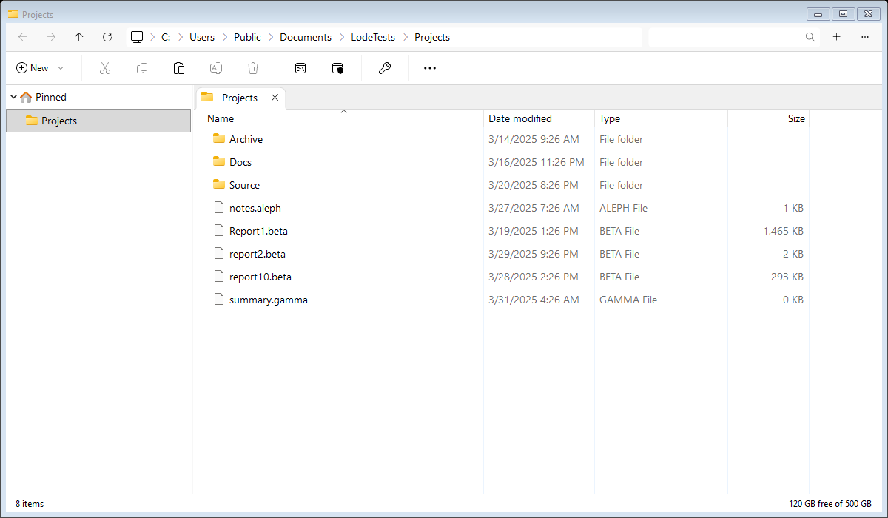


## Install

Lode ships as a [dotnet tool](https://learn.microsoft.com/en-us/dotnet/core/tools/global-tools), [Lode](https://www.nuget.org/packages/Lode). It needs the .NET Desktop Runtime 11 or later.

```
dotnet tool install -g Lode
```


### Updating

Once a day Lode checks nuget.org for a newer version, prereleases included. When it finds one, a link beside the free space at the bottom of each window says so. Click it, or open the **Updates** page of **Options**, and click **Update and restart**. Lode closes, a hidden PowerShell runs `dotnet tool update` for the tool path Lode is installed in, and then starts Lode again with the tabs it had. The tray icon then says whether the update worked. **Check now** on the same page checks straight away.

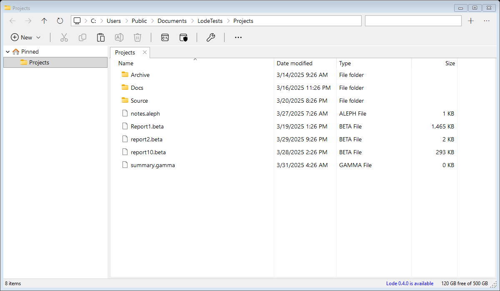

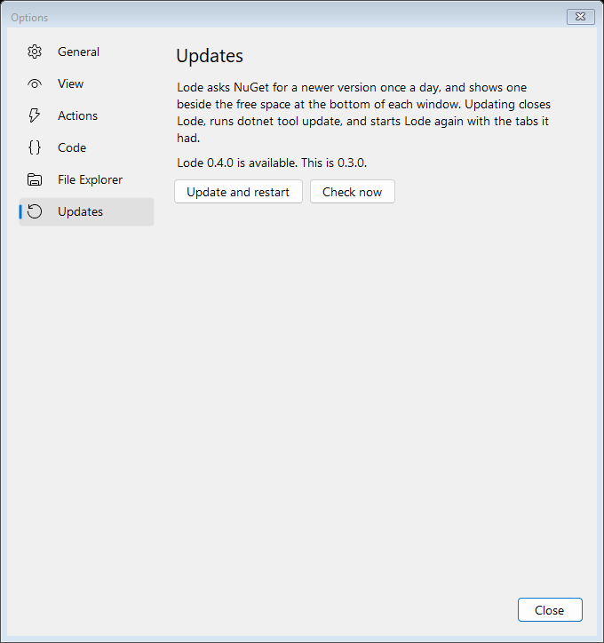

Only a copy installed as a dotnet tool checks for updates. A local build has nothing to update.


## Run

```
lode
lode D:\Code
lode D:\Code\readme.md
```

Pass a folder to open it, or a file to open its folder with that file selected. With no arguments the tabs from last time are reopened. `lode --help` lists the switches.

From source: `dotnet run --project src/Lode`.


## Replacing File Explorer

```
lode --replace-explorer
lode --restore-explorer
```

The same two actions are buttons on the **File Explorer** page of **Options**, in the ⋯ menu at the right of the address bar. Replacing makes Lode what opens folders and drives (double-clicks, folder shortcuts, other apps opening a folder) and what Win+E starts. Restoring undoes it, and puts back whichever app was the default for folders before.

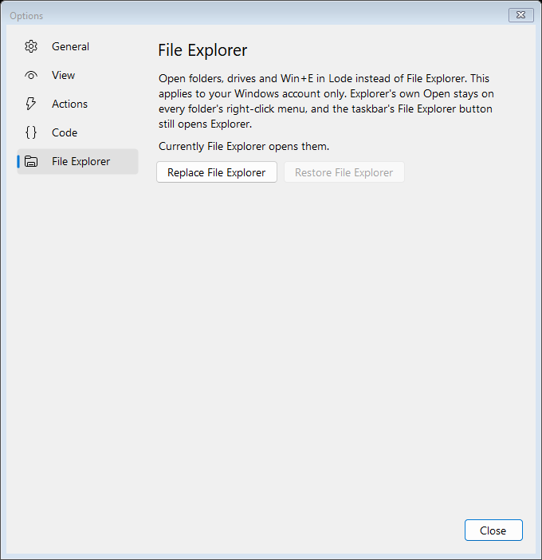

 * It writes only to `HKEY_CURRENT_USER\Software\Classes`, so it applies to the current Windows account and needs no administrator rights.
 * Folders are pointed at the installed tool (`%USERPROFILE%\.dotnet\tools\lode.exe`) whenever it exists, even when Replace is clicked in a local build, so cleaning a build folder never breaks opening folders. Only without the tool is the running copy registered.
 * Explorer's own **Open** stays on every folder's right-click menu.
 * The taskbar's File Explorer button, and apps that start `explorer.exe` themselves or ask it to show a file selected, still open Explorer.
 * Run `lode --restore-explorer` before uninstalling the tool. Otherwise folders keep pointing at a Lode that is no longer there.


### Going back to File Explorer

Any one of these works:

 * In Lode, open **Options** from the ⋯ menu, pick **File Explorer**, and click **Restore File Explorer**.
 * From a terminal, run `lode --restore-explorer`.
 * If Lode is already uninstalled, or will not start, remove its registry entries by hand:

   ```
   reg delete "HKCU\Software\Classes\Directory\shell\Lode" /f
   reg delete "HKCU\Software\Classes\Drive\shell\Lode" /f
   reg delete "HKCU\Software\Classes\Directory\shell" /ve /f
   reg delete "HKCU\Software\Classes\Drive\shell" /ve /f
   reg delete "HKCU\Software\Classes\CLSID\{52205fd8-5dfb-447d-801a-d0b52f2e83e1}" /f
   ```

   The first two remove the **Open in Lode** verb. The next two clear the default folder action, which Lode set to itself, so Explorer's **Open** takes over again. The last one removes Lode's Win+E command. Only delete that key if Lode added it: check that `HKCU\Software\Classes\CLSID\{52205fd8-5dfb-447d-801a-d0b52f2e83e1}\shell\opennewwindow` has a `CreatedBy` value of `Lode`. If another app was the default for folders before Lode, removing the entries by hand does not bring it back, unlike Restore. Its name is in the `LodePreviousDefault` value of the `Lode` key, so read that before deleting the key.

After restoring, folders open in Explorer straight away. If one still opens in Lode, sign out and back in, or restart Explorer from Task Manager.


## Features

 * Address bar that shows each folder up the path as a button, with chevrons between, as Explorer does, with This PC as an icon: click a folder to go there. The chevrons are only separators, without Explorer's drop-down lists. Click the empty space after the path, or press Ctrl+L, to type a path instead.
 * Actions bar under the address bar, with a button for any of the right-click menus' actions: New, Cut, Copy, Paste, Rename, Delete, Terminal, Terminal (admin) and Properties by default, each enabled when it applies to the selection, or to the folder when nothing is selected. On the **Actions** page of Options, tick which actions show as buttons and which in the right-click menus (the list's, and the folder tree's). The rest are under **See more** (⋯) at the end of the bar, as in Explorer. Menu entries have icons too.

   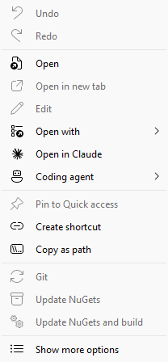 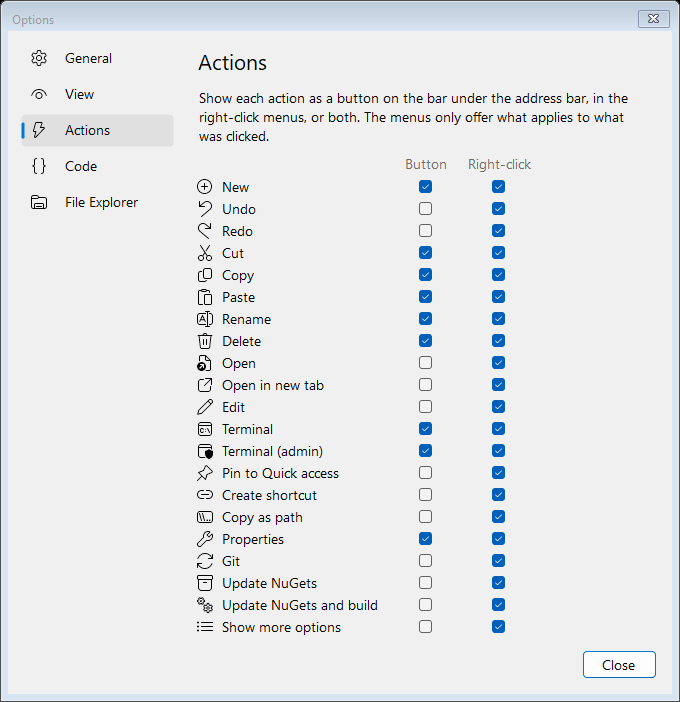

 * Tabs, each with its own back/forward history and a cross to close it. Right-click a tab to duplicate it, close it, close the others, those to its left or right, or all of them. **Reopen closed tab** (Ctrl+Shift+T) brings back the last tab closed in that window, at the folder it was showing.

   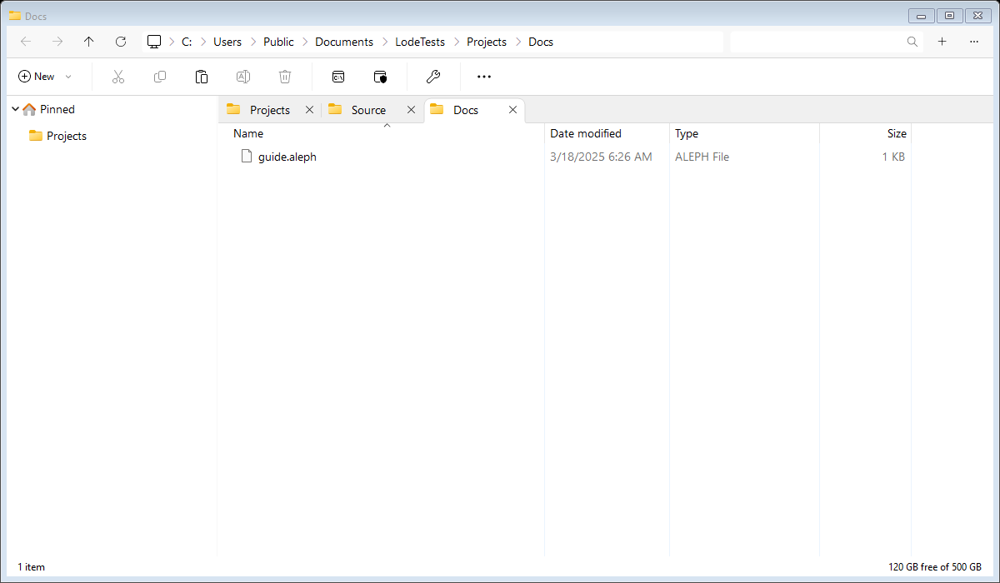

 * **Command palette** (Ctrl+Shift+P, or the ⋯ menu): type part of a command's name and press Enter. It lists the window's commands (navigation, tabs, hidden items, terminal, pinning, options) and whatever the right-click menu offers for the selection, or for the folder when nothing is selected.

   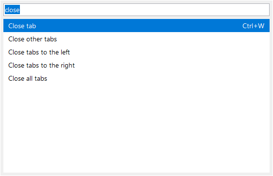

 * Drag a tab off the tab row to open it in a window of its own, or onto another Lode window to move it there, history and all.
 * Lives in the tray. Closing the last window hides it; click the tray icon (or launch Lode again) to bring it back, or Shift+click it for a new window, and choose **Exit** from the tray menu or the ⋯ menu to quit. The tray icon is put on the taskbar rather than in the overflow, unless you have moved it there yourself.
 * One copy per Windows account. Launching Lode again, including a folder opened from Explorer when Lode replaces it, hands the folders to the running copy, which opens them in a new window. All windows share that one process, so tabs can be dragged between any of them.
 * Folder tree with a **Pinned** section (folders pinned to Quick access in Explorer), a **Recent** section (folders Explorer adds to Quick access because you use them often), then the drives. It follows the active tab. To pin a folder, drag it (or a tab) onto the **Pinned** heading, right-click it (in the list or the tree) and choose **Pin to Quick access**, or use **Pin this folder to Quick access** in the ⋯ menu for the folder the tab shows. Both unpin too. Drag a pinned folder up or down the **Pinned** list to reorder it, as in Explorer, or select it and press Alt+Shift+Up or Alt+Shift+Down. Pins made in Explorer are read when Lode starts. Right-clicking a folder in the tree offers what a folder in the list gets: Open, Terminal, Cut, Copy, Paste into it, Rename, Delete, Create shortcut and so on. Drives can't be cut, renamed or deleted, and Pinned and Recent entries can't be renamed.
 * Details list with shell icons and type names, natural sort order, and click-to-sort columns. As in Explorer, there is a margin left of the list: drag from it to select the rows the rectangle covers (Ctrl+drag adds to the selection), or click it to clear the selection. Right-click the column headers to size a column, or all of them, to fit, or to hide or show Date modified, Type and Size, in every tab and window; Name always shows.

   

 * A short right-click menu that opens at once: Open, Terminal and Terminal (admin) (on a folder, or empty space), Cut, Copy, Rename, Delete, Create shortcut, Copy as path, Properties and so on. **Create shortcut** puts a `name - Shortcut.lnk` beside each selected item, as Explorer does. On empty space, **New** lists Folder and the file types Windows offers under New (Text Document and whatever installed apps add); the new item is ready to rename. **Show more options** at the bottom, or Shift+right-click, opens the classic Windows context menu, with installed shell extensions (7-Zip, Open with, and so on), less Send to, Include in library, Restore previous versions and Edit in Notepad.

   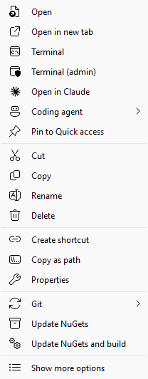 

 * **Options** in the ⋯ menu, a page each, picked from the list down the left as in Windows' Settings (Ctrl+Tab and Ctrl+Shift+Tab go through them). Changes apply straight away.
   * **General**: the default folder new tabs open in, and the text editor.
   * **View**: show hidden items (on by default; also Ctrl+H), show system files (off by default: Windows, Program Files, other people's folders under Users, and the files Windows protects, in the list and the folder tree), and show the Recent section.
   * **Actions**: which actions show as buttons and which in the right-click menus.
   * **Code**: the code folder, whether Git purge deletes permanently, and excluding the code folder from Microsoft Defender.
   * **File Explorer**: replace or restore it.

   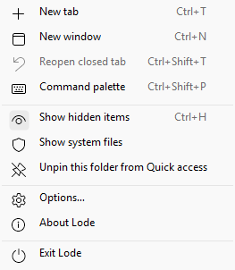 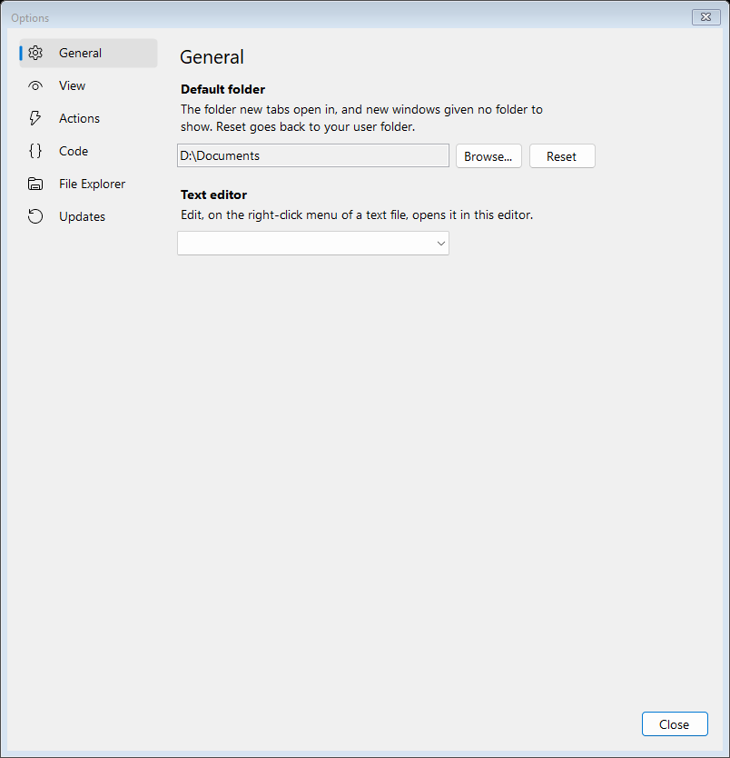 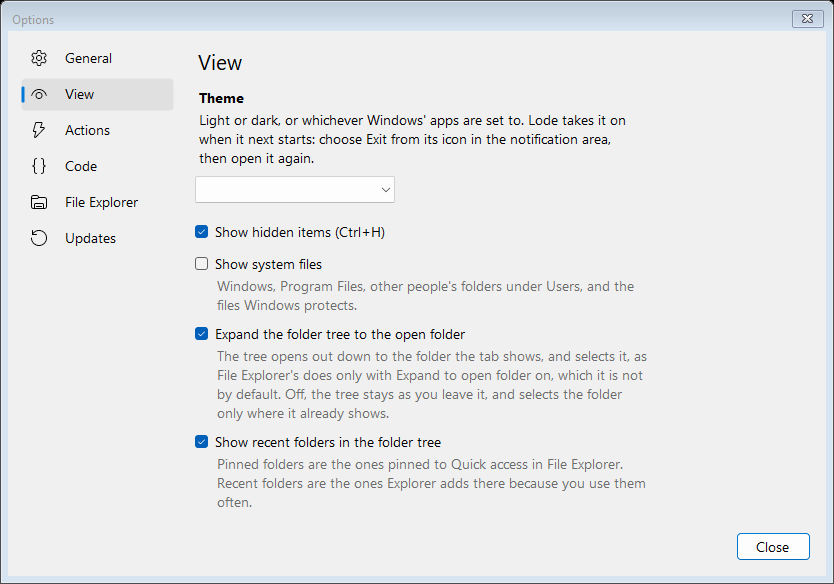

 * **Edit** on the right-click menu of text files opens them in the text editor chosen on the **General** page of Options. Installed editors (Visual Studio Code, Notepad++ and others) are found from the registry; Notepad is always there.
 * **Code folder**: on the **Code** page of Options, choose the folder your git repositories are in. **Exclude from Defender…** on the same page stops Microsoft Defender scanning the folder, as Rider offers to, which speeds up builds and git: after asking, it runs a PowerShell script with administrator permission that adds the folder to Defender's exclusions and removes the exclusions already under it, which that makes redundant. Folders in it get a **Git** submenu (Pull, Push, Discard, across every repository up to two levels down, and Purge) and **Update NuGets** (optionally then building) on their right-click menu. Push, Discard and Purge ask first.
   * **Rider keeps asking** to exclude each project from Defender after this. Reading Defender's exclusions needs administrator permission, so Rider never checks them and can't see that the code folder already covers the project. The recommended fix is to turn its notification off for all projects, from **More** on the notification. Its **Exclude folders** does no harm, but it only adds an exclusion the code folder already covers, and the notification comes back for every new project. Rider's caches, under `AppData\Local\JetBrains`, aren't in the code folder. With the notification off, nothing will remind you to exclude the new folder there after a Rider update.
   * **Purge** deletes every file and folder git doesn't track, ignored ones included (bin, obj, node_modules and the like): what `git clean -xdf` would, leaving repositories nested inside alone. In a repository, or a folder anywhere inside one, it purges just that folder. In a folder that isn't in a repository, it purges every repository under it, however deep. Everything goes to the Recycle Bin in one go, unless **Delete them permanently** is ticked on the Code page of Options, which is faster. Its line in the Actions panel lists what went.
   * Each runs in the background and shows in an **Actions** panel under the folder tree, with progress while it runs; click a line for everything it reported, right-click to remove lines.

   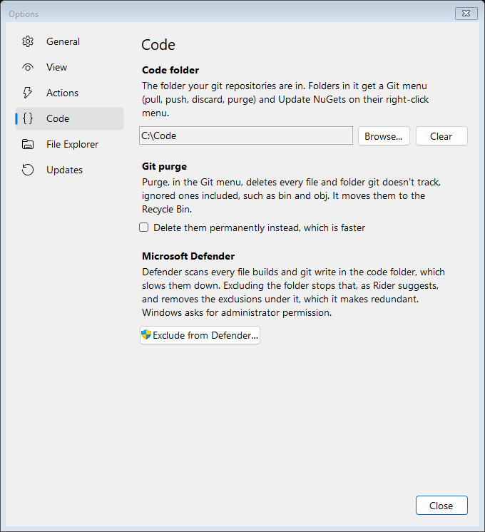 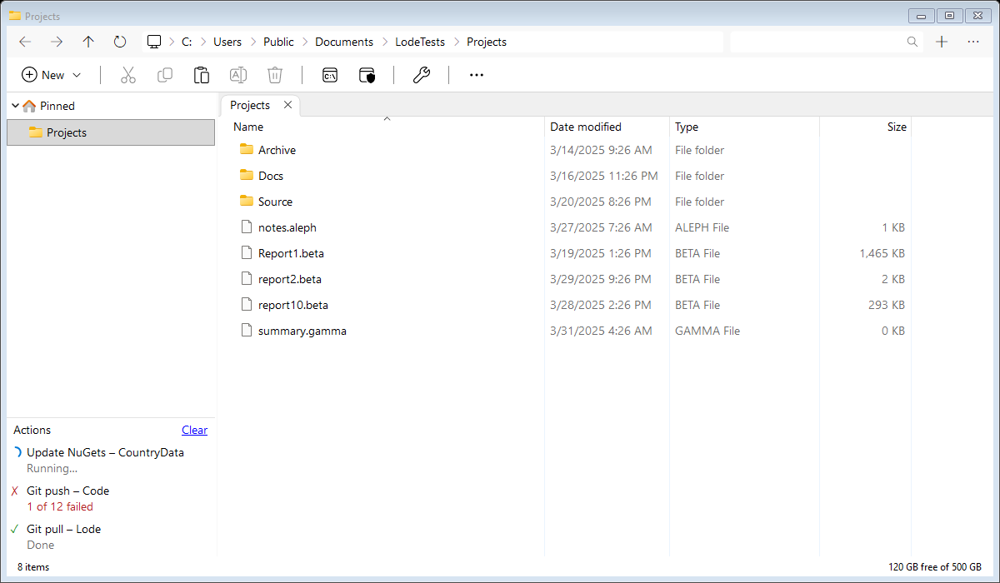

 * Copy, move, delete and rename go through the Windows shell (IFileOperation, as Explorer uses): standard progress dialog, conflict prompts, Recycle Bin and undo. Paths longer than 260 characters work.
 * **Undo** (Ctrl+Z) and **Redo** (Ctrl+Y or Ctrl+Shift+Z), across every window: renames, moves, copies, deletes to the Recycle Bin, and new folders, files and shortcuts. Lode reverses each itself: a rename or move is done back, a copy or new item goes to the Recycle Bin, a deleted item is restored from it. Also on the right-click menu of empty space, under See more, and in the command palette, worded for what they would do ("Undo rename"). Permanent deletes can't be undone.
 * Drag and drop to and from Explorer and other apps.
 * Filter box: type part of a name, or a wildcard such as `*.cs`.

   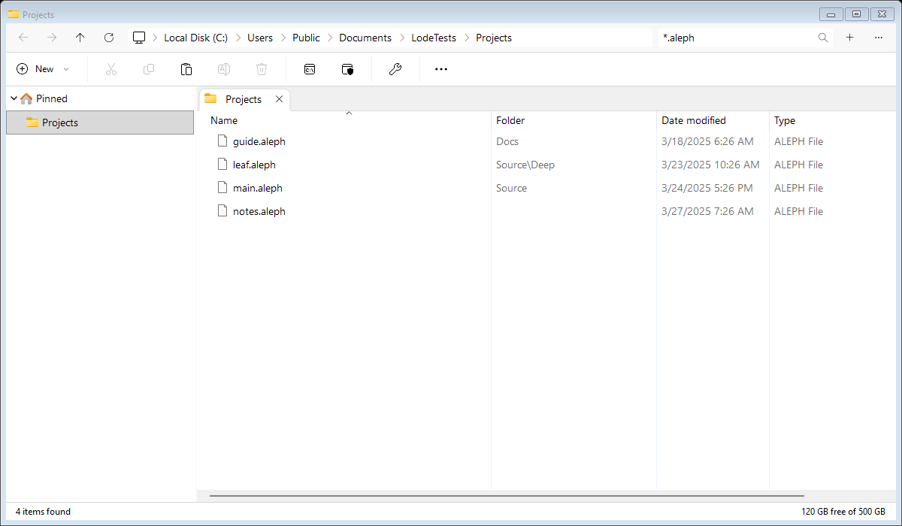

 * The list refreshes itself when the folder changes on disk. Lode lets go of a drive's folders while Windows removes, locks or dismounts it, so it never blocks **Safely remove**, and watches them again if that is called off.
 * A shell extension in another process that stops answering (a packaged app's command, a cloud provider) is cut off after 3 seconds when **Show more options** builds its menu, and skipped for the rest of the session, as Files does. Extensions loaded into Lode itself can't be cut off.
 * Window size, open tabs and the options are remembered in `%AppData%\Lode\settings.json`. With several windows open, the last one closed is what the next start restores. A Debug build (from source) keeps its own `settings.debug.json`, first copied from `settings.json`, and runs as a copy of its own beside the installed Lode, with " (Lode Debug)" after its window titles.

## Keyboard

| Keys                              | Action                        |
|-----------------------------------|-------------------------------|
| Alt+Left / Backspace, Alt+Right   | Back, forward                 |
| Alt+Up                            | Up one level                  |
| Ctrl+T, Ctrl+W                    | New tab, close tab            |
| Ctrl+Shift+T                      | Reopen closed tab             |
| Ctrl+Shift+P                      | Command palette               |
| Ctrl+Tab, Ctrl+Shift+Tab          | Next tab, previous tab        |
| Ctrl+L, Alt+D, F4                 | Address bar                   |
| Ctrl+F, F3                        | Filter box                    |
| F5                                | Refresh                       |
| F2                                | Rename                        |
| Delete, Shift+Delete              | Recycle, delete permanently   |
| Ctrl+C, Ctrl+X, Ctrl+V            | Copy, cut, paste              |
| Ctrl+Z, Ctrl+Y                    | Undo, redo                    |
| Ctrl+Shift+N                      | New folder                    |
| Alt+Enter                         | Properties                    |
| Ctrl+H                            | Show or hide hidden items     |
| Ctrl+N                            | New window                    |

Click a tab's cross or middle-click the tab to close it. The mouse back and forward buttons work too.
