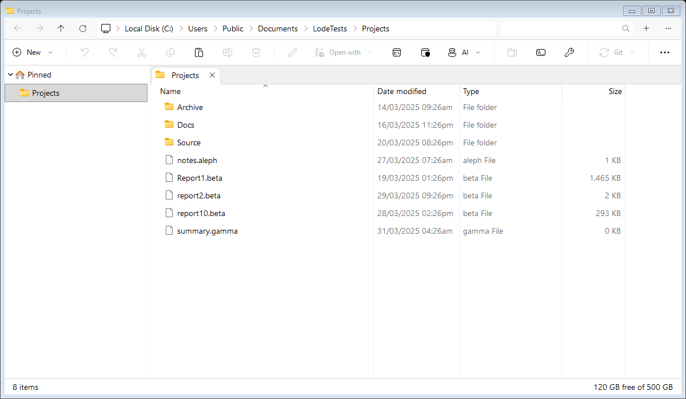
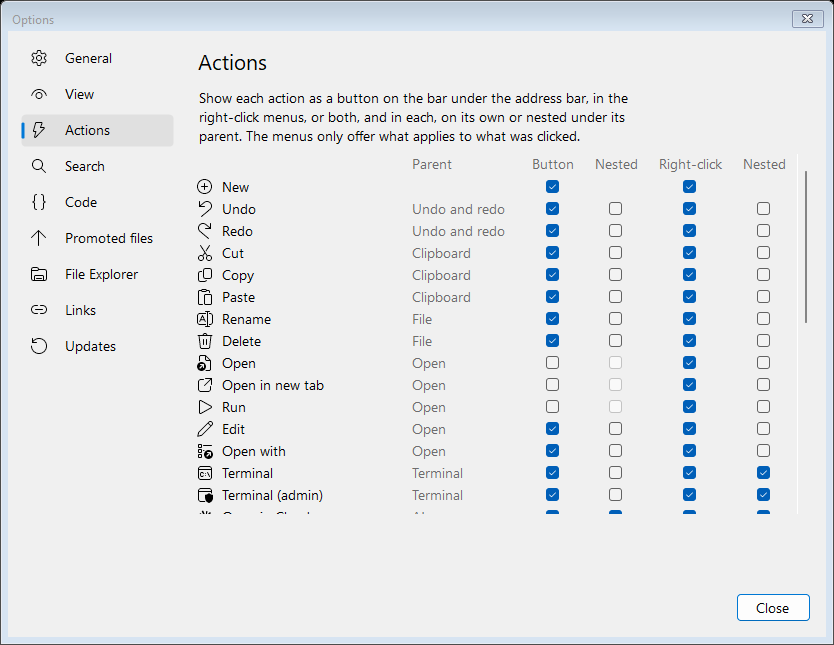
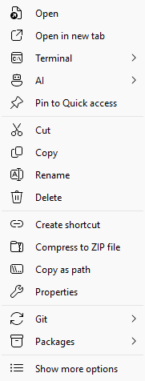
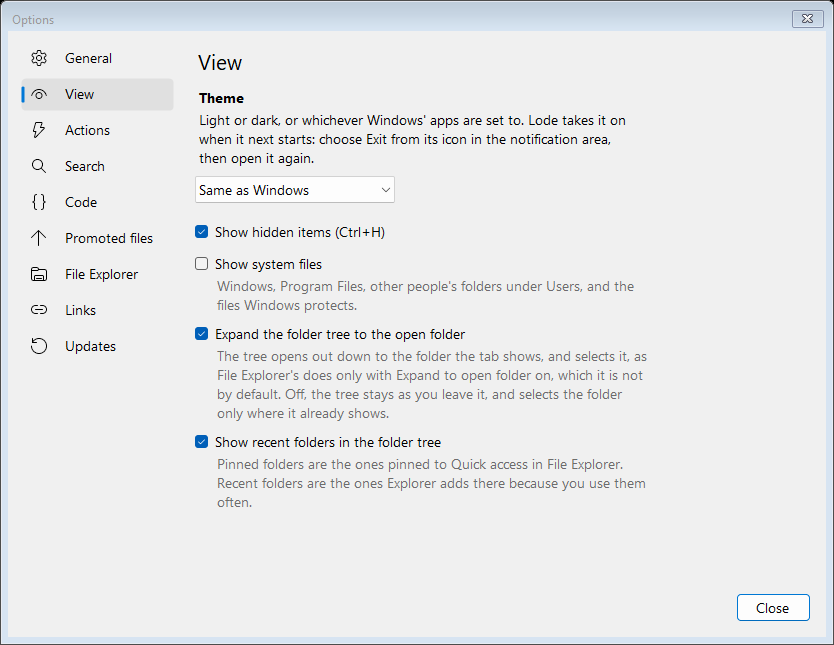
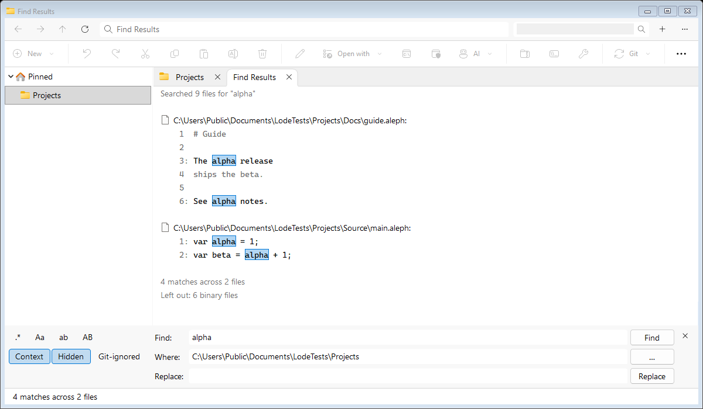

#   Lode

[](https://github.com/SimonCropp/Lode/actions/workflows/build.yml)
[](https://www.nuget.org/packages/Lode/)

Alternative to Windows Explorer with a focus on developers.




## Why Lode exists

File Explorer is made for everyone. A developer's day is spent in folders of code, and much of it in Explorer is spent leaving Explorer: for a terminal, for git, for a tool that clears out a build. Lode is a file manager for that day.

 * The right-click menu opens at once. Explorer's waits on the shell extensions installed apps add to it, so it can be slow to appear, and on Windows 11 the classic menu, where most of those extensions are, is a second step behind **Show more options**. Lode's own menu touches no shell extension, so nothing holds it up, and the full Windows menu is still a click, or a Shift+right-click, away.
 * The tools are on the folder. Opening a terminal in it, pulling or pushing every repository under it, deleting what git doesn't track (bin, obj and the like), updating NuGets, or starting a coding agent there would otherwise mean switching to another app and finding the folder again. In Lode each is on the folder's right-click menu, the actions bar and the command palette, and works on several folders at once. Excluding the code folder from Defender, which speeds up builds and git, is one button.
 * Nothing to relearn. Lode looks and behaves like Windows 11's Explorer, and does what Explorer does the way Explorer does it: copies, moves and deletes go through the Windows shell, with its progress dialog, conflict prompts, Recycle Bin and undo; Quick access pins are the same ones Explorer has; drag and drop works with Explorer and other apps. It can stand in for Explorer, so Win+E and folders other apps open land in Lode, and hand back to Explorer as easily.
 * It installs where developers already are. It is a dotnet tool, so one command installs it, and it keeps itself up to date.


## Install

Lode ships as a [dotnet tool](https://learn.microsoft.com/en-us/dotnet/core/tools/global-tools), [Lode](https://www.nuget.org/packages/Lode). It needs the .NET Desktop Runtime 11 or later.

```
dotnet tool install -g Lode
```


### Updating

Once a day Lode checks nuget.org for a newer version, prereleases included. When it finds one, a link beside the free space at the bottom of each window says so. Click it, or open the **Updates** page of **Options**, and click **Update and restart**, which waits for anything running in the Actions panel to finish. Lode closes, a hidden PowerShell runs `dotnet tool update` for the tool path Lode is installed in, and then starts Lode again with the tabs it had. The tray icon then says whether the update worked. **Check now** on the same page checks straight away.

A newer Lode, said in the status bar beside the free space:


The **Updates** page of **Options**, with **Update and restart**:


Only a copy installed as a dotnet tool checks for updates. A local build has nothing to update.


## Run

```
lode
lode D:\Code
lode D:\Code\readme.md
```

Pass a folder to open it, or a file to open its folder with that file selected. With no arguments the tabs from last time are reopened. `lode --help` lists the switches.

From source: `dotnet run --project src/Lode`. Benchmarks, of how a search merges what it finds, of reading repositories' state by running git against LibGit2Sharp, and of what Lode does with each change it hears in the code folder: `dotnet run -c Release --project src/Lode.Benchmarks`. With the `LodeBenchmarkCode` environment variable naming a code folder, the git state benchmark reads its repositories too.


## Replacing File Explorer

```
lode --replace-explorer
lode --restore-explorer
```

The same two actions are buttons on the **File Explorer** page of **Options**, in the ⋯ menu at the right of the address bar. Replacing makes Lode what opens folders and drives (double-clicks, folder shortcuts, other apps opening a folder) and what Win+E starts. Restoring undoes it, and puts back whichever app was the default for folders before.


 * It writes only to `HKEY_CURRENT_USER\Software\Classes`, so it applies to the current Windows account and needs no administrator rights.
 * Folders are pointed at the installed tool (`%USERPROFILE%\.dotnet\tools\lode.exe`) whenever it exists, even when Replace is clicked in a local build, so cleaning a build folder never breaks opening folders. Only without the tool is the running copy registered.
 * Explorer's own **Open** stays on every folder's right-click menu.
 * Apps that ask the shell to *explore* a folder, rather than open it, get Lode too. Electron and Chromium apps open folders this way, GitHub Desktop's **Show in Explorer** for one. They ask for the verb on Windows' Folder class, which covers virtual folders as well, so Lode hands the ones it can't show (Control Panel, the Recycle Bin, libraries) to Explorer; This PC it shows itself. If another file manager has already claimed that verb, it keeps it. A copy of Explorer's own verb in the user's classes, which some tools leave there when they hand folders back to Explorer, is taken over rather than left as another tool's, and restoring gives it back to Explorer. A Replace by a Lode from before this was added leaves those apps opening Explorer: the **File Explorer** page of **Options** says so, and replacing again covers them.
 * Apps that ask the shell to show a file selected get it selected in Lode: GitHub Desktop's **Show in Explorer** on a changed file, a browser's **Show in folder** for a download, VS Code's **Reveal in File Explorer**. The shell looks for the file's folder among the windows registered with it, as Explorer's are, so while Lode opens folders each of its tabs is registered there under the folder it shows. The tab found selects the file, and comes to the front, from the background too; with none, the folder opens in a new tab, which selects the file once it shows. A window in the tray is left out, as it is when another launch hands over a folder, and so is a folder on the network. Before this, the folder opened with nothing selected, after the app had waited 20 seconds for a window that never came.
 * The taskbar's File Explorer button, and apps that start `explorer.exe` themselves (`explorer /select,` to show a file selected, say), still open Explorer.
 * Run `lode --restore-explorer` before uninstalling the tool. Otherwise folders keep pointing at a Lode that is no longer there.


### Going back to File Explorer

Any one of these works:

 * In Lode, open **Options** from the ⋯ menu, pick **File Explorer**, and click **Restore File Explorer**.
 * From a terminal, run `lode --restore-explorer`.
 * If Lode is already uninstalled, or will not start, remove its registry entries by hand:

   ```
   reg delete "HKCU\Software\Classes\Directory\shell\Lode" /f
   reg delete "HKCU\Software\Classes\Drive\shell\Lode" /f
   reg delete "HKCU\Software\Classes\Directory\shell" /ve /f
   reg delete "HKCU\Software\Classes\Drive\shell" /ve /f
   reg delete "HKCU\Software\Classes\Directory\shell\explore" /f
   reg delete "HKCU\Software\Classes\Drive\shell\explore" /f
   reg delete "HKCU\Software\Classes\Folder\shell\explore" /f
   reg delete "HKCU\Software\Classes\CLSID\{52205fd8-5dfb-447d-801a-d0b52f2e83e1}" /f
   ```

   The first two remove the **Open in Lode** verb. The next two clear the default folder action, which Lode set to itself, so Explorer's **Open** takes over again. The three after that hand the explore verb back to Explorer, and the last one removes Lode's Win+E command. Only delete those last four keys if Lode added them: check that each `explore` key, and `HKCU\Software\Classes\CLSID\{52205fd8-5dfb-447d-801a-d0b52f2e83e1}\shell\opennewwindow`, has a `CreatedBy` value of `Lode`. If that Win+E key's `command` has a `LodePreviousCommand` value, Lode took Win+E from another app rather than adding it: copy that value back to the `command` key's default value, and `LodePreviousDelegateExecute` to its `DelegateExecute`, rather than deleting the key. If another app was the default for folders before Lode, removing the entries by hand does not bring it back, unlike Restore. Its name is in the `LodePreviousDefault` value of the `Lode` key, so read that before deleting the key.

After restoring, folders open in Explorer straight away. If one still opens in Lode, sign out and back in, or restart Explorer from Task Manager.


## Repository links

Code sites have buttons that hand a repository to a desktop app. On the **Links** page of **Options**, Lode can take those links over, so the repository opens in a Lode tab from the code folder instead:

 * GitHub's **Open with GitHub Desktop**, on a repository's Code button, a pull request, or a file. These are `x-github-client://openRepo/…` links. A file's link opens the repository's folder with the file selected.
 * GitHub's **Open with Visual Studio**, and Azure DevOps' **Clone in Visual Studio**. These are `git-client://clone?repo=…` links.


Each has an **Open in Lode** button, and a **Revert** button that gives the links back to the app they were for. The two kinds are separate, so GitHub Desktop's links can go to Lode while Visual Studio keeps its own, or the other way round.

 * The clone is found among the repositories up to two levels into the code folder, by its origin. https, ssh, a user name in the url, and Azure DevOps' older `visualstudio.com` urls all count as the same repository. Lode doesn't switch to the branch a pull request's link names.
 * A link for a repository that isn't in the code folder, or with no code folder chosen, is offered to the app it was for, GitHub Desktop or Visual Studio, which can clone it. Other links of those apps that don't name a repository, GitHub Desktop's sign-in say, go straight to the app.
 * It writes only to `HKEY_CURRENT_USER\Software\Classes\x-github-client` and `…\git-client`, so it needs no administrator rights. The command that was there before is kept beside Lode's, and Revert puts it back. A scheme key Lode added, Visual Studio's, which is registered for the whole machine, goes again.
 * If GitHub Desktop registers its links again, as it may when it updates, it takes them back from Lode. The **Links** page then says GitHub Desktop opens them: click **Open in Lode** again.
 * An app chosen for these links in Windows' **Default apps** comes before Lode's command. The **Links** page says so when there is one.


## Features

 * Address bar that shows each folder up the path as a button, with chevrons between, as Explorer does, with This PC as an icon: click a folder to go there. The chevrons are only separators, without Explorer's drop-down lists. Click the empty space after the path, or press Ctrl+L, to type a path instead. One that is not full, `src`, `..` or `\Code`, is taken from the folder open, as in Explorer. The shell's names for folders, `shell:downloads` or `shell:startup` say, go to them. Anything else that isn't somewhere in the folder open, `cmd`, `powershell`, `wt` or `code .`, is run there, as Explorer runs it, found as the Run box finds a program.
 * Actions bar under the address bar, with a button for any of the right-click menus' actions: New, Cut, Copy, Paste, Rename, Delete, Terminal, Terminal (admin) and Properties by default, each enabled when it applies to the selection, or to the folder when nothing is selected. On the **Actions** page of Options, tick which actions show as buttons and which in the right-click menus (the list's, and the folder tree's). The rest are under **See more** (⋯) at the end of the bar, as in Explorer. Menu entries have icons too.

   Most actions have a parent: Clipboard (Cut, Copy, Paste, Copy as path), Undo and redo, File (Rename, Delete, Create shortcut, Compress to ZIP file, Extract All, Extract here, Pin to Quick access), Open (Open, Open in new tab, Run, Edit, Open with), Terminal (both terminals), AI (Open in Claude, Coding agent), Git (Git fetch, Git pull, Git switch to default branch, Git push, Git tag, Git delete tag, Git discard, Git purge) and Packages (Update NuGets, and with a build). Each **Nested** box on the Actions page puts the action under its parent: in the right-click menus, a submenu where the first of them would be, and on the bar, a drop-down button. Under Git, the git actions drop the "Git": Fetch, Pull, Switch to default branch, Push, Tag, Delete tag, Discard and Purge. The right-click menus start with the terminals, the AI actions, Git and Packages nested; nothing on the bar is nested until you tick it.

   **See more** (⋯), at the end of the bar, with the actions that aren't buttons, those that don't apply to the selection greyed:

   

   The **Actions** page of **Options**, which places each action as a button, in the right-click menus, or both, nested or not:

   

 * Tabs, each with its own back/forward history and a cross to close it. Right-click a tab to duplicate it, pin its folder to Quick access or unpin it, close it, close the others, those to its left or right, or all of them. **Reopen closed tab** (Ctrl+Shift+T) brings back the last tab closed in that window, at the folder it was showing, or the nearest folder above it still there if that has gone. As in Explorer, a tab follows the folder it shows when it is renamed, by Lode or another program, or moved by Lode, whether the folder itself or one above it, keeping what was selected; places in its history inside the folder follow too, so Back goes where they went. When the folder is deleted, sent to the Recycle Bin, or moved by another program, the tab goes up to the nearest folder still there.

   Tabs pile up as other apps open folders in Lode, each in a tab of its own. To have Lode close the ones you have stopped using, tick **Close tabs not looked at for** on the **General** page of Options and give the hours, 24 unless changed. A tab is looked at while it is the one a window shows, in a window that is not minimized or in the tray; a tab opened in the background counts from when it opened. Lode never closes the tab a window shows, so never a window's last, and waits until you have gone to another app, so no tab moves out from under the pointer. Each closes as Close tab would, so Reopen closed tab brings it back. When each tab was last looked at is kept with the tabs, so restarting Lode, to update it say, doesn't start the hours again.

   

 * **Command palette** (Ctrl+Shift+P, or the ⋯ menu): type part of a command's name and press Enter. It lists the window's commands (navigation, tabs, hidden items, terminal, Claude, coding agents, pinning, options) and whatever the right-click menu offers for the selection, or for the folder when nothing is selected. With a folder selected, Terminal, Open in Claude and Coding agent open in that folder, as on its right-click menu.

   

 * Drag a tab along the tab row to put it elsewhere among the tabs, as in a browser; Escape puts it back. Drag it off the row, anywhere in its own window or beyond it, to open it in a window of its own, or onto another Lode window to move it there, history and all: dropped between two of that window's tabs, it goes in there, and anywhere else, at the end. The tabs open next time in the order they were left in.
 * Lives in the tray. Closing the last window hides it, and closes for good any window already there, so the tray holds the window closed last; click the tray icon (or launch Lode again) to bring it back, or Shift+click it for a new window, and choose **Exit** from the tray menu or the ⋯ menu to quit, which asks first while anything in the Actions panel is still running. The tray icon is put on the taskbar rather than in the overflow, unless you have moved it there yourself.
 * One copy per Windows account. Launching Lode again, including a folder opened from Explorer or another app (GitHub Desktop's **Show in Explorer**, say) when Lode replaces it, hands the folders to the running copy. Each opens in a new tab in the Lode window used last, which comes to the front. A folder a tab already shows, in any window, selects that tab and brings its window to the front instead; a file selects itself in the tab showing its folder. With every window closed to the tray, the folders open in a new window. Launching Lode with no folder (Win+E, say) brings back the window in the tray, or opens a new window when there is none. All windows share that one process, so tabs can be dragged between any of them.
 * Jump list, as Explorer has: right-click Lode's button on the taskbar, or a pin of Lode, for the folders pinned to Quick access under **Pinned**, then those Quick access adds because you use them often (the tree's Recent) under **Frequent**, each with the icon Explorer gives it, Desktop's and Downloads' included, and named as its tab would be. Click one to open it in Lode, as a folder handed over by another launch opens. The taskbar keeps the list, so it is there while Lode is closed; Lode writes it again when it starts and when a folder is pinned or unpinned in Lode. Pinned folders take the first of the entries Windows shows (10 unless changed), and Frequent gets the rest. Windows lets no app add to the taskbar's own Pinned section, the one Explorer's pins are in, so Lode's Pinned is a section of its own: **Remove from this list** leaves a folder out of the list, for as long as Quick access has it, without unpinning it, and the pin beside an entry pins it in the list, in a Pinned section of the taskbar's above Lode's, rather than to Quick access.
 * Folder tree with a **Pinned** section (folders pinned to Quick access in Explorer), a **Recent** section (folders Explorer adds to Quick access because you use them often), then the drives. A drive plugged in or mapped shows in the tree, and in This PC, as soon as Windows has it, and one taken out or disconnected goes, as in Explorer. It follows the active tab: whichever folder the tab shows, however it got there, the tree opens out down to it and selects it. Explorer's navigation pane only does that with **Expand to open folder** turned on in its Folder Options, and that is off by default, so going into a folder from the list, the address bar or Back leaves Explorer's pane where it was. To have Lode's tree stay as you leave it instead, turn off **Expand the folder tree to the open folder** on the **View** page of Options: the tree then selects the folder only where it already shows, under This PC or in **Pinned** or **Recent**, and otherwise nothing. To pin a folder, drag it (or a tab) into the **Pinned** list: onto the heading to pin it at the end, or to the top or bottom of a pinned folder to pin it there, where the line shows, as in Explorer (onto the middle of one drops into it), right-click it (in the list or the tree), or the tab showing it, and choose **Pin to Quick access**, or use **Pin this folder to Quick access** in the ⋯ menu for the folder the tab shows. Each of those menus unpins too. Drag a pinned folder up or down the **Pinned** list to reorder it, as in Explorer, or select it and press Alt+Shift+Up or Alt+Shift+Down. Pins made in Explorer are read when Lode starts. Right-clicking a folder in the tree offers what a folder in the list gets: Open, Terminal, Cut, Copy, Paste into it, Rename, Delete, Create shortcut and so on, and **New**, which opens the folder in the tab and makes the folder or file there, with its name ready to edit, as New in the list does. Drives can't be cut, renamed or deleted, and Pinned and Recent entries can't be renamed. Their keys work on the folder selected in the tree too, where the menu would allow them: F2, Delete (and Shift+Delete), Ctrl+X, Ctrl+C, Ctrl+V, Ctrl+Shift+C for Copy as path, Alt+Enter, and Ctrl+Shift+N for a new folder. Right-clicking **This PC** offers what Explorer's menu for it does, less Delete and Rename: Expand or Collapse, **Manage**, **Map network drive**, **Disconnect network drive**, Open in new tab, **Open in new window**, **Add a network location** and Properties (also Alt+Enter). Those that are Windows' own open the same windows they do from Explorer. **Show more options**, or Shift+right-click, gives Windows' menu for This PC, again without Delete and Rename.

   

 * Details list with shell icons and type names, natural sort order, and click-to-sort columns. A shortcut shows the icon of what it points at, with the shell's arrow in the corner, as Explorer draws it. What is cut, in Lode or in Explorer, shows dimmed until it is pasted or something else is copied, as Explorer shows it. As in Explorer, there is a margin left of the list: drag from it to select the rows the rectangle covers (Ctrl+drag adds to the selection), or click it to clear the selection. Right-click the column headers to size a column, or all of them, to fit, or to hide or show Date modified, Type, Size and Git, in every tab and window; Name always shows. Date modified reads as 01/11/2026 01:11pm, whatever Windows' own date format is, and a Type nothing is registered for keeps its extension in lower case, "aleph File" where Windows says "ALEPH File". A column widened or narrowed, by its divider or sized to fit, is that wide in every tab and window, and the next time Lode starts. As in Explorer, each folder keeps the sort it was last given, in any tab and from one start to the next, so Downloads sorted by date stays so; a folder never sorted is by name.

   

 * A short right-click menu that opens at once: Open, Terminal and Terminal (admin) (on a folder, or empty space; on several folders, one Windows Terminal window with a tab for each), Cut, Copy, Rename, Delete, Create shortcut, Copy as path, Properties and so on. **Create shortcut** puts a `name - Shortcut.lnk` beside each selected item, as Explorer does. On files of one type, **Open with** lists the apps Windows recommends for it, with their icons, as Explorer does; for a single file, **Choose another app** opens Windows' own dialog, which can also make the app the default. Programs and shortcuts get no Open with, as in Explorer. On empty space, **New** lists Folder and the file types Windows offers under New (Text Document and whatever installed apps add, less Access databases, which nobody makes from a folder's menu); the new item is ready to rename. **Show more options** at the bottom, or Shift+right-click, opens the classic Windows context menu, with installed shell extensions (7-Zip and so on), less Send to, Include in library, Restore previous versions and Edit in Notepad. Its Delete, Create shortcut, and New's Folder and file types are done by Lode, as from its own menu, so Ctrl+Z can undo them, and a new item is ready to rename.

   The right-click menu on a folder:

   

   **New**, on the right-click menu of empty space, with Folder and the file types Windows offers:

   

 * **Options** in the ⋯ menu, a page each, picked from the list down the left as in Windows' Settings (Ctrl+Tab and Ctrl+Shift+Tab go through them). Changes apply straight away.
   * **General**: the default folder new tabs open in, the text editor, and closing tabs not looked at for a while (off by default).
   * **View**: the theme, light, dark, or the same as Windows' apps (the default), which Lode takes on when it next starts, as it does a change to Windows' own, Windows' own menus included, such as **Show more options**; show hidden items (on by default; also Ctrl+H), show system files (off by default: Windows, Program Files, other people's folders under Users, and the files Windows protects, in the list and the folder tree), expand the folder tree to the open folder (on by default, unlike Explorer's), and show the Recent section.
   * **Actions**: which actions show as buttons and which in the right-click menus, and in each, which are nested under their parent.
   * **Search**: how many lines Find in Files shows either side of each match, and turning Windows Search off for good, or on again. Lode doesn't use Windows Search, whose indexing goes on in the background: off, Start, Settings, Outlook and OneNote find no files, and Explorer's search is slower. **Turn off…** stops the service and disables it; **Turn on…** sets it starting shortly after Windows does, as Windows has it, and starts it. Each asks first, then runs a PowerShell script with administrator permission. The page says how the service is now.
   * **Code**: the code folder, whether Git purge deletes permanently, and excluding the code folder from Microsoft Defender.
   * **File Explorer**: replace or restore it.
   * **Links**: open GitHub's and Azure DevOps' repository links for GitHub Desktop and Visual Studio in Lode, or revert them. See [Repository links](#repository-links).

   The ⋯ menu, at the right of the address bar:

   

   The **General** page of **Options**:

   

   The **View** page of **Options**:

   

 * **Edit** on the right-click menu of text files opens them in the text editor chosen on the **General** page of Options. Installed editors (Visual Studio Code, Notepad++ and others) are found from the registry; Notepad is always there.
 * **Run** on the right-click menu of PowerShell scripts (`.ps1`), whose Open usually only shows them in Notepad, runs each in a Windows Terminal tab of its own, in the script's folder: by PowerShell 7 where it is on the PATH, otherwise by Windows PowerShell. The tab stays at a prompt once the script ends, so what it wrote can be read. As Explorer's Run with PowerShell does, the execution policy is bypassed for that tab unless it is AllSigned, so an unsigned or downloaded script still runs; a policy set by Group Policy still applies.
 * **Open in Claude** on the right-click menu of a folder, or of empty space, starts a new Claude Code session in that folder in the [Claude desktop app](https://claude.com/download), as the app's own `ccd` command does. It only shows when the app is installed. A session works in one folder, so with several selected it is greyed out. It is also in the command palette, and can be made a button on the **Actions** page of Options.
 * **Coding agent** on the same menus lists the coding agents installed that run in a terminal: [Claude Code](https://code.claude.com), [GitHub Copilot CLI](https://github.com/github/copilot-cli), [Codex CLI](https://github.com/openai/codex) and [Gemini CLI](https://github.com/google-gemini/gemini-cli). Pick one to start it in a Windows Terminal tab in the folder, or a tab in each of several folders, as Terminal opens them. They are found as Windows finds a command, on the PATH, and in Claude Code's own install folder, once as Lode starts, behind the window: one installed while Lode runs shows up once Lode is restarted. Without any, Coding agent isn't offered.
 * **Code folder**: on the **Code** page of Options, choose the folder your git repositories are in. Lode watches it while it runs, to keep the Git column up to date, so Windows won't let a folder the code folder is in be renamed or moved, and if the code folder itself is renamed, moved or deleted, Lode goes on looking for it where it was. Choosing one asks first, saying so: before doing any of that, **Clear** it in Options, or exit Lode. A code folder that is no longer there when Lode starts is said so, to be chosen again. **Exclude from Defender…** on the same page stops Microsoft Defender scanning the folder, as Rider offers to, which speeds up builds and git: after asking, it runs a PowerShell script with administrator permission that adds the folder to Defender's exclusions and removes the exclusions already under it, which that makes redundant. Folders in it get a **Git** submenu (Fetch, Pull, Switch to default branch, Push, Tag, Delete tag, Discard, on the repository the folder is in, or across every repository up to two levels down, and Purge) and **Update NuGets** (optionally then building) on their right-click menu. Across several repositories, git runs in six at a time. **Fetch** learns what origin has for each, changing no branch, so the Git column's behind and ahead are up to date: run on the code folder, it shows which repositories a Pull would bring anything into. Push, Discard and Purge ask first. **Tag** asks for a name, tags the commit each repository is at, and pushes the tag to origin. **Delete tag** offers the repositories' tags, newest first, and deletes the one picked from each repository and from origin; one never pushed goes from the repository alone. Switch to default branch isn't offered for a repository on it already, as the files git keeps say, and Push isn't for one with nothing to push, no change to a tracked file and no commit the branch it tracks hasn't got, once its Git state has been read; for a folder holding repositories, both always are. With several folders selected, each takes in all of them at once, asking once, as one line in the Actions panel.
  * **Git state**: a **Git** column, beside the name, in folders in the code folder. In one that lists repositories, the code folder itself say, it says where each is: its branch, or the commit it is detached at, then how many changes there are not yet committed, staged or not, each file one, and a new file, or a new folder of them, one too, as `git status` lists them, and how many commits it is ahead of and behind the branch it tracks, as of the last fetch, each only when there is any: `main · 3 changes · 2 ahead`. Sorting by it groups the repositories by branch. In a repository, or a folder anywhere inside one, the status bar says that of the repository, and in a folder of repositories, the code folder say, that of a repository selected on its own, which its branch and the rest then act on, with a link beside it to the repository's page when its origin is on GitHub, Azure DevOps, GitLab or Bitbucket, and the column what has become of each file: Modified (changes not yet staged, whatever is staged too), Staged, Added, Renamed, Deleted, Untracked or Conflicted, in amber, green or red, and of each folder how many changes it holds. A file unchanged says nothing, so what has changed stands out, and sorting by the column brings it together. A search in a repository says the same of what it finds. Each file keeps its own icon: the change is beside it, not drawn over it, where it would be a few pixels and would cover the shortcut arrow. As TortoiseGit does, each repository is read once and kept until something in it changes: Lode watches the code folder, everything in it and nothing else, and a change to a repository's files, or in its `.git` (a commit made in a terminal, say, or a pull), has it read again once the changes stop for a second, so files saved one after another, by an editor or an agent say, are read once, and no later than 3 seconds after they began. A folder gone back to, the code folder say, shows its repositories at once and reads none of them that haven't changed. Two views showing the one repository, the code folder in two windows say, read it once between them. What git writes for itself, that no state shows, is no change: objects, its logs, locks, and the files its fsmonitor daemon makes and deletes for every status. Nor is a change in a folder git ignores, `bin` and `obj` say, so a build has nothing read: the first change in a folder has Lode ask, of the repository, whether git ignores it, and those after are dropped if it does, unless it holds a file git tracks all the same. That is asked again once a `.gitignore`, the index or the repository's config changes. A repository whose files go on changing while reading it finds nothing new, a log written to it say, is read less and less often, from every 3 seconds to once a minute, until the changes stop, or one of them is git's own: a commit, a stage or a pull is still read at once. A worktree and a submodule keep their index and HEAD not in themselves but in the `.git` of the repository they are of: a change there, a commit in the worktree say, is read as theirs, and a branch moved, which worktrees share, as a change to each of them, so long as that repository is in the code folder too. Refresh (F5) reads them all again. In a code folder that can't be watched, on a share say, they are read whenever the folder is, and when its tab or the window comes back to the front. A repository of fewer than 2,000 files is read in Lode itself, with [LibGit2Sharp](https://github.com/libgit2/libgit2sharp), which saves starting git; one of more by `git status`, which looks over the files on several threads and is faster there. A code folder of 91 repositories is read in 341 ms so, where git alone takes 590 ms and LibGit2Sharp alone 534 ms. Reading takes no lock, so a commit made meanwhile never finds the repository busy. Like the git actions, none of this is outside the code folder. How it works, with diagrams, is in [docs/git-status.md](docs/git-status.md).
   * **Switch to default branch** switches each repository to the branch origin's HEAD names, main say: as the clone recorded it, or, in a repository made with `git init` and given an origin afterwards, which has none recorded, as origin says when asked. Where there is no local branch of that name yet, git makes one tracking origin's. A repository with anything uncommitted, staged or not, or a file git doesn't track, fails and stays on its branch, and its line in the Actions panel lists what is uncommitted; the other repositories are still switched. It switches only: a Pull afterwards brings the branch up to date.
   * **Switch branch**: click the branch in the status bar, or press Ctrl+B, and the repository's branches open above it, as GitHub Desktop's Current branch list does: origin's default branch, then up to five switched to most recently, newest first, as git's reflog has them, then the rest, local before origin's. One only on origin, that no local branch tracks, is listed as `origin/feature`, and switching to it makes a local branch of its name, tracking it. Each says how long ago it was last committed to; the one checked out is ticked. Type to filter them, a word or several, and Enter, or a click, switches to the one highlighted, in the Actions panel. With anything uncommitted, Lode asks first, as GitHub Desktop does: **Leave my changes** on the branch stashes them, untracked files too, to be put back when you switch to that branch again from the status bar, which marks it *stashed changes* meanwhile; **Bring my changes** takes them along, unless git would have to overwrite any, when nothing is switched. Should the switch fail after leaving them, they are put back at once. Changes left on a branch that has since moved on in a way that clashes with them, or that you come back to with other changes, stay stashed, and its line in the Actions panel says so. Detached, they come along without asking. **New branch** asks for a name, starting from what was typed, makes the branch at the commit checked out, and switches to it, changes and all; Enter does that too when no branch matches. The list is of the branches git knows: a fetch or Pull brings origin's new ones. Right-click a branch, or press the Apps key on it, for GitHub Desktop's entries: **Rename…** a local one (the branch it tracks on origin keeps its name), **Copy branch name**, **Checkout in new worktree…**, which asks for a folder, beside the repository and named for it and the branch unless you say otherwise, makes a worktree of the branch there, one only on origin getting a local branch of its name tracking it, and opens it in a tab (not the branch checked out, which git won't check out twice), and **Delete…**, which asks first, offering to delete the branch it tracks on origin too, deletes it merged or not, saying in the Actions panel the commit it was at, switches off it first to the default branch if it's checked out, and deletes one only on origin from origin.
   * **Acting on the state**: the status bar's state is in the same font as the folder tree, with a branch before it, and each part of it does what it says when clicked, asking first. **N behind** offers to **Pull**, or to **Fetch**, to see what origin has now, as behind is as of the last fetch; diverged, it offers **Pull, then push** too. **N ahead** offers to **Push** the commits, committing nothing; diverged, origin would refuse the push, so it offers **Pull, then push** instead. **N changes** lists the files, and offers **Commit and push…** and **Discard…**, as the right-click menu has them, the first left off where it would have nothing to commit: only files git doesn't track, or detached. Each runs in the Actions panel, and the status bar follows at once.
   * **Rider keeps asking** to exclude each project from Defender after this. Reading Defender's exclusions needs administrator permission, so Rider never checks them and can't see that the code folder already covers the project. The recommended fix is to turn its notification off for all projects, from **More** on the notification. Its **Exclude folders** does no harm, but it only adds an exclusion the code folder already covers, and the notification comes back for every new project. Rider's caches, under `AppData\Local\JetBrains`, aren't in the code folder. With the notification off, nothing will remind you to exclude the new folder there after a Rider update.
   * **Purge** deletes every file and folder git doesn't track, ignored ones included (bin, obj, node_modules and the like): what `git clean -xdf` would, leaving repositories nested inside alone. In a repository, or a folder anywhere inside one, it purges just that folder. In a folder that isn't in a repository, it purges every repository under it, however deep. It asks once it has found what will go, saying how many items and how big, and naming the first ten. Everything goes to the Recycle Bin in one go, unless **Delete them permanently** is ticked on the Code page of Options, which is faster. Its line in the Actions panel lists what went.
   * Each runs in the background and shows in an **Actions** panel under the folder tree, with progress while it runs; click a line for everything it reported, right-click to remove lines, or to cancel a Pull, Switch to default branch, Push or Discard still running. A line that went well, or was cancelled, leaves a minute after it finished, so the panel needn't be cleared by hand; one that failed stays until removed. Git is told not to ask for anything, since nobody could answer it there: ssh fails, rather than waits, on a key with a passphrase no agent holds or a host it doesn't know yet, unless you have set an ssh command of your own.

   The **Code** page of **Options**, with the code folder, how Git purge deletes, and excluding the folder from Defender:

   

   The **Actions** panel under the folder tree, with one action running, one that failed and one done:

   

 * Copy, move, delete and rename go through the Windows shell (IFileOperation, as Explorer uses): standard progress dialog, conflict prompts, Recycle Bin and undo. Paths longer than 260 characters work. What is pasted is selected once it is there, as in Explorer. Something gone since it was picked, deleted by another program after it was cut say, is left out and Lode says so, rather than the shell doing none of it. Windows won't move or rename a folder, or send it to the Recycle Bin, while a program is watching a folder inside it, so Lode stops watching the folders inside one while it does that: a tab open inside the folder, or a folder expanded beneath it in the tree, doesn't stop it. Another program can't move a folder a Lode tab is open inside, as it can't one an Explorer window is open inside.
 * **Undo** (Ctrl+Z) and **Redo** (Ctrl+Y or Ctrl+Shift+Z), across every window: renames, moves, copies, deletes to the Recycle Bin, and new folders, files and shortcuts. Lode reverses each itself: a rename or move is done back, a copy or new item goes to the Recycle Bin, a deleted item is restored from it. A folder copied, moved or renamed onto one of the same name merges into it, and undoing that takes back only what it brought, leaving what was there before. On a drive with no Recycle Bin, a USB stick or a share, Windows asks before undoing a copy deletes it for good, and that can't be redone. One that can't be done twice running, access denied say, is let go, so what was done before it can still be undone. Also on the right-click menu of empty space, under See more, and in the command palette, worded for what they would do ("Undo rename"). Permanent deletes can't be undone.
 * Drag and drop to and from Explorer and other apps. The folder a drag would drop into is highlighted, in the list and the tree, as in Explorer. In the tree, as in Explorer's pane, a closed folder held over for a moment opens, the tree scrolls when a drag is near its top or bottom, and folders drag out to the list, Explorer or another app (a drive as a shortcut). A folder can't be dropped into one inside it. Drag with the right button to be asked, on dropping, as in Explorer: Copy here, Move here or Create shortcuts here, with what a drag with the left button would do in bold.
 * Zips, as in Explorer:
   * **Compress to ZIP file** on the right-click menu of anything selected, in the list or the tree, makes a zip of it beside it, named for the first item (`notes.zip`, then `notes (2).zip`), with folders under their own names and all they hold, empty folders included. The new zip is selected with its name ready to edit. It runs in the Actions panel, with progress, and can be cancelled there, which leaves no part of the zip behind. Undo sends the zip to the Recycle Bin.
   * **Extract All** on the right-click menu of zips extracts each to a new folder beside it named for it (`Bundle`, then `Bundle (2)`), and **Extract here** into the folder the zip is in, merging into folders already there. Extract here writes nothing when anything it would write is there already, and its line in the Actions panel lists what. Either way, what was extracted is selected, and Undo sends what the extract made to the Recycle Bin. An entry named to go outside the folder (`..\`, a rooted path), or with a name Windows can't have, is left out, and the Actions panel says so.
   * Double-click a zip, or type its path, to go into it as a folder, and into the folders in it, with the address bar, Back, Up and tabs working as anywhere else; a tab inside a zip opens there again when Lode restarts. Lode reads the zip itself, without the shell's zip folder, and doesn't change it: nothing can be made, pasted, dropped, cut, renamed or deleted there, and **Show more options**, which would change it, isn't offered. A file opened from a zip is extracted to `%Temp%\Lode\Zip` and opened from there, so changes saved to it stay out of the zip, as in Explorer, and a program that needs the files beside it, a page's images say, won't find them. Copy and drag extract to the same place first, so what is pasted or dropped is ordinary files. A zip in a zip is extracted there and gone into. A zip written to while a tab is inside it is read again; renamed, the tab follows it, and deleted, the tab goes to the folder it was in. Extracts more than a day old are cleared away when Lode starts.
 * Search box: type part of a name, or a wildcard such as `*.csproj`. What the folder itself has that matches shows at once. Then its subfolders are searched, all the way down, and what they hold that matches is added as it is found, with a **Folder** column saying where each is. Hidden and system items are left out, as they are from the list, and links to other folders (junctions and symbolic links) aren't followed. It stops once it has found 100,000 in the subfolders, which the status bar says, as a search for a letter on a drive would find millions: type more to narrow it. What it finds is merged in behind the window, which only gives the list its rows, so the window stays as quick however much is found. What the subfolders hold is as it was when found: F5 searches again. **Search inside the files**, in the status bar beside how many were found, or Ctrl+Enter in the box, searches for it in what the files hold instead, with Find in Files, in the folder open: as text, or for a wildcard, the text between the stars at either end, and where there are more, as a regular expression. Where nothing's name matches, the list offers it too, under "No items match your search.". **Show more options** and **Properties** need everything selected to be in the one folder. On This PC the box narrows the drives.

   

 * **Find in Files** (Ctrl+Shift+F, also in the ⋯ menu and the command palette) searches what files hold, as Sublime Text's does, without Windows Search: every file is read and looked through as it is, several at once, so nothing needs indexing first and what is found is never out of date. A strip opens along the bottom of the window, with the folder open in **Where**:
   * **Find**: text, in any case unless **Aa** is on, or with **.\*** on a .NET regular expression, `^` and `$` at each line's start and end. **ab** wants it as a whole word.
   * **Where**: entries split by commas, as Sublime's are. A folder or a file, in full or from the folder open; `<open folders>` for every folder the window's tabs show; a pattern a file must match, `*.cs`; and after a minus one it, or a folder it is in, mustn't, `-*.min.js` or `-node_modules\`. A pattern with a slash in it is matched against the path from the folder searched, `-*\obj\`, and one ending in a slash only against folders. The **…** beside it adds a folder, the folder open, the open folders, or a filter to finish typing. Opening the strip on another folder changes Where's folder and keeps its filters.
   * **Inside a git repository**, only what git doesn't ignore is searched, as `git ls-files --cached --others --exclude-standard` lists it: a `.gitignore`, `info/exclude` and your `core.excludesFile` all count, and a file git tracks in an ignored folder is still searched. The folders git ignores, `bin`, `obj` and `node_modules` say, aren't even gone into, which is most of what makes it quick. A repository nested in another, or in a folder that isn't one, is searched by what it ignores. **Git-ignored** searches all of it. In the code folder what git lists is kept until something in the repository changes, so searching again, refining what is looked for, doesn't start git each time. Where git can't list a repository, it is searched whole, and the results say so.
   * **Hidden** files are searched unless it is turned off. `.git`, `.hg` and `.svn` folders never are. A file with a nul in its first 8,000 bytes is binary, as git has it, and left out, as is one over 64 MB; the results say how many. Text is read in the encoding its byte order mark says, UTF-8 or UTF-16, or else as UTF-8, or, when it isn't valid UTF-8, Latin-1.
   * **The Find Results tab** shows what was found as Sublime does: what was searched for, then each file's full path and its lines, numbered, a colon after the number of each that matches, with the matches marked, two lines either side for **Context** (how many is on the **Search** page of Options), `..` where lines are left out between them, and at the end how many matches across how many files. Files are in the order the folders are listed, each folder's files before its subfolders, whichever finished first, and are added as they are found. Enter, or a double-click, opens the file in the text editor at the line, the cursor on the match: VS Code and its forks, Sublime Text, Zed and Notepad++ are told the line; Notepad and others just open the file. **F4** and **Shift+F4** go to the next match and the one before, opening each. Right-click for Show in folder, Copy path, Copy line and Copy all results, as text in the same layout, and Remove from results (Delete), which leaves the file out of Replace too. Esc stops a search. F5 searches again. A long line, of minified script say, is cut down round its first match, and past 200,000 lines the rest of the files are listed with how many matches each has. The tab isn't a folder's: it isn't opened again when Lode restarts, and stays in its window.
   * **Replace**, with what is in the Replace box, in every file of the results, as each is now: in a regular expression `$1` and `${name}` are its groups, and with **AB** on, Preserve case, the replacement takes each match's case, all capitals, all small, or a capital first. It asks first, saying how many occurrences in how many files, and runs in the Actions panel, which can cancel it. Each file is written back where it is, in the encoding it was read in, byte order mark, line endings and all, so it keeps its links and attributes; one that is read-only, or whose text wouldn't come back to the same bytes, is left, and the Actions panel says why. Find Results then shows each line replaced. **Undo** (Ctrl+Z) puts back each file still as Replace left it, from a copy kept in `%Temp%\Lode\Replace`, and Redo writes the replacement again; a file changed since is left as it is, and said so.
   * Alt+R, Alt+C, Alt+W, Alt+A and Alt+X turn regex, case, whole word, preserve case and context on and off, as in Sublime, and Up and Down in each box go back through what was typed there. The toggles and the last twenty of each are remembered.

   

 * The list refreshes itself when the folder changes on disk, even after the folder is deleted and made again, as a build emptying its output folder does. Lode lets go of a drive's folders while Windows removes, locks or dismounts it, so it never blocks **Safely remove**, and watches them again if that is called off.
 * A shell extension in another process that stops answering (a packaged app's command, a cloud provider) is cut off once it has kept **Show more options** waiting 3 seconds, and skipped for the rest of the session, as Files does. Extensions loaded into Lode itself can't be cut off, and none is skipped for a menu merely slow to build.
 * Window size, open tabs and the options are remembered in `%AppData%\Lode\settings.json`. With several windows open, the last one closed is what the next start restores, and after **Exit**, the one used last. A Debug build (from source) keeps its own `settings.debug.json`, first copied from `settings.json`, and runs as a copy of its own beside the installed Lode, with " (Lode Debug)" after its window titles.

## Keyboard

| Keys                              | Action                        |
|-----------------------------------|-------------------------------|
| Alt+Left / Backspace, Alt+Right   | Back, forward                 |
| Alt+Up                            | Up one level                  |
| Ctrl+T, Ctrl+W                    | New tab, close tab            |
| Ctrl+Shift+T                      | Reopen closed tab             |
| Ctrl+Shift+P                      | Command palette               |
| Ctrl+B                            | Switch branch                 |
| Ctrl+Tab, Ctrl+Shift+Tab          | Next tab, previous tab        |
| Ctrl+1 to Ctrl+8, Ctrl+9          | That tab, the last tab        |
| Ctrl+L, Alt+D, F4                 | Address bar                   |
| Ctrl+F, F3                        | Search box                    |
| Ctrl+Shift+F                      | Find in Files                 |
| Ctrl+Enter (search box)           | Search inside the files       |
| F4, Shift+F4 (Find Results)       | Next match, previous match    |
| F5                                | Refresh                       |
| F2                                | Rename                        |
| Delete, Shift+Delete              | Recycle, delete permanently   |
| Ctrl+C, Ctrl+X, Ctrl+V            | Copy, cut, paste              |
| Ctrl+Shift+C                      | Copy as path                  |
| Ctrl+Z, Ctrl+Y                    | Undo, redo                    |
| Ctrl+Shift+N                      | New folder                    |
| Alt+Enter                         | Properties                    |
| Ctrl+H                            | Show or hide hidden items     |
| Ctrl+N                            | New window                    |

Click a tab's cross or middle-click the tab to close it. The mouse back and forward buttons work too.


## Icon

https://thenounproject.com/icon/navigation-4075063/