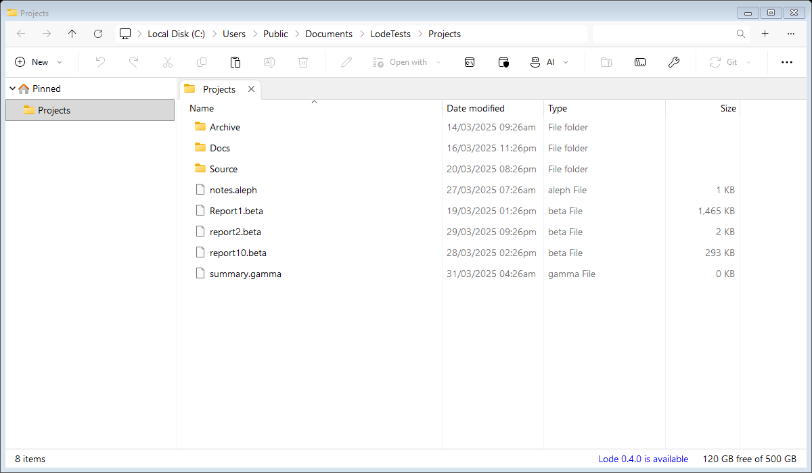
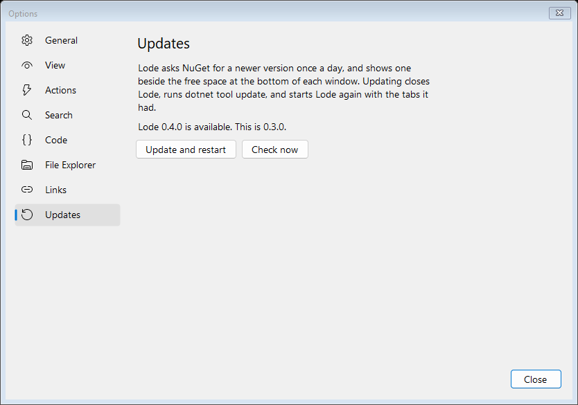
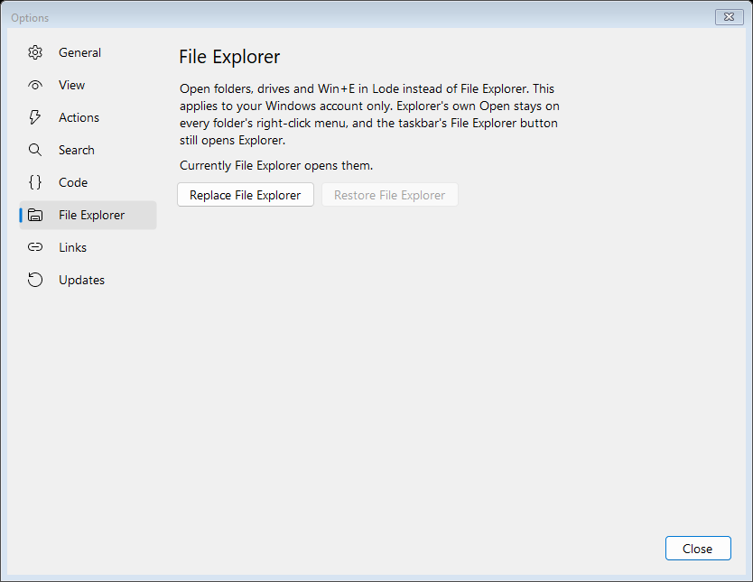
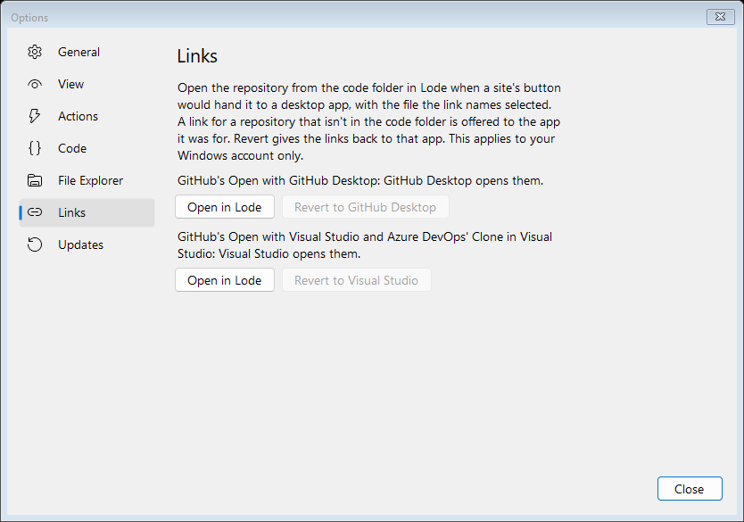
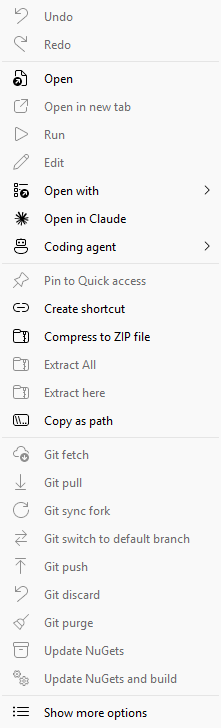
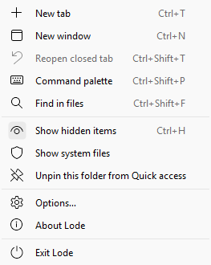
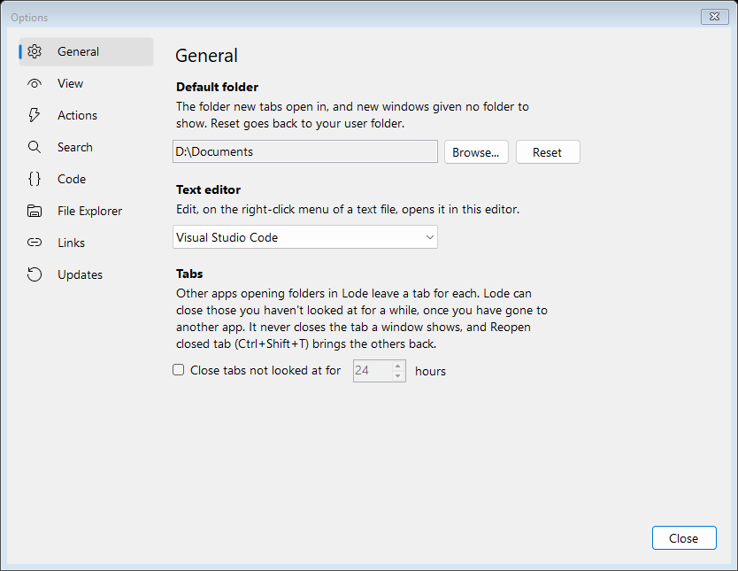
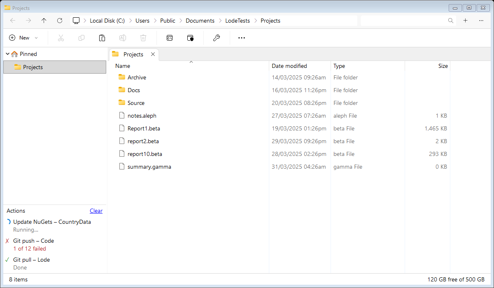

#   Lode

[](https://github.com/SimonCropp/Lode/actions/workflows/build.yml)
[](https://www.nuget.org/packages/Lode/)

Alternative to Windows Explorer with a focus on developers.


## Highlights

 * [A right-click menu that opens at once](#right-click-menu), touching no shell extension, with the full Windows menu a click away.
 * [Git on the folder](#code-folder): fetch, pull, push, tag, discard and purge every repository under it, from the right-click menu, the actions bar or the command palette.
 * [The state of each repository and file](#git-state) in a Git column and the status bar.
 * [Coding agents](#coding-agent) and [Claude](#open-in-claude) started in the folder.
 * [Find in Files](#find-in-files), with replace, leaving out what git ignores.
 * [A search box](#search-box) that searches every folder beneath, as quick however much it finds.
 * [Tabs](#tabs), dragged between windows.
 * Has a [command palette](#command-palette).
 * [Undo and redo](#undo) of renames, moves, copies and deletes, across every window.
 * [Stands in for File Explorer](#replacing-file-explorer), so Win+E and folders other apps open land in Lode, and [opens repository links](#repository-links) from GitHub Desktop and Visual Studio.
 * [Installs as a dotnet tool](#install), and says when there is a newer version, which one click installs.


## Install

Lode ships as a [dotnet tool](https://learn.microsoft.com/en-us/dotnet/core/tools/global-tools), [Lode](https://www.nuget.org/packages/Lode). It needs the .NET Desktop Runtime 11 or later.

```
dotnet tool install -g Lode
```


### Updating

Once a day Lode checks nuget.org for a newer version, prereleases included, and says so in the status bar. Click it, or **Update and restart** on the **Updates** page of **Options**: once nothing is running in the Actions panel, Lode closes, runs `dotnet tool update`, and starts again with the tabs it had. **Check now** checks straight away. A local build doesn't check.

A newer Lode, in the status bar:



The **Updates** page of **Options**:




## Run

```
lode
lode D:\Code
lode D:\Code\readme.md
```

A folder opens it; a file opens its folder with it selected; nothing reopens the tabs from last time. `lode --help` lists the switches.

From source: `dotnet run --project src/Lode`. Benchmarks: `dotnet run -c Release --project src/Lode.Benchmarks`, with `LodeBenchmarkCode` naming a code folder for the git state benchmark to read.


## Replacing File Explorer

```
lode --replace-explorer
lode --restore-explorer
```

Also buttons on the **File Explorer** page of **Options**. Replacing makes Lode what opens folders and drives, from double-clicks, folder shortcuts and other apps, and what Win+E starts. Restoring puts back whichever app opened folders before.



 * It writes only to `HKEY_CURRENT_USER\Software\Classes`: the current account, no administrator rights.
 * Folders are pointed at the installed tool (`%USERPROFILE%\.dotnet\tools\lode.exe`) whenever it exists, so cleaning a build folder never breaks opening folders.
 * Explorer's own **Open** stays on folders' right-click menus.
 * Apps that ask to *explore* a folder, as Electron apps do (GitHub Desktop's **Show in Explorer**), get Lode too. Folders Lode can't show (Control Panel, the Recycle Bin, libraries) go to Explorer.
 * Apps that show a file selected (a browser's **Show in folder**, VS Code's **Reveal in File Explorer**) get it selected in Lode, in the tab showing its folder, or a new one.
 * The taskbar's File Explorer button, and apps that start `explorer.exe` themselves, still open Explorer.
 * Run `lode --restore-explorer` before uninstalling the tool.


### Going back to File Explorer

 * In Lode: **Options**, **File Explorer**, **Restore File Explorer**.
 * From a terminal: `lode --restore-explorer`.
 * If Lode is uninstalled, or won't start, remove its registry entries by hand:

   ```
   reg delete "HKCU\Software\Classes\Directory\shell\Lode" /f
   reg delete "HKCU\Software\Classes\Drive\shell\Lode" /f
   reg delete "HKCU\Software\Classes\Directory\shell" /ve /f
   reg delete "HKCU\Software\Classes\Drive\shell" /ve /f
   reg delete "HKCU\Software\Classes\Directory\shell\explore" /f
   reg delete "HKCU\Software\Classes\Drive\shell\explore" /f
   reg delete "HKCU\Software\Classes\Folder\shell\explore" /f
   reg delete "HKCU\Software\Classes\CLSID\{52205fd8-5dfb-447d-801a-d0b52f2e83e1}" /f
   ```

   Delete the last four only if Lode added them: each `explore` key, and the CLSID key's `shell\opennewwindow`, has a `CreatedBy` value of `Lode`. If that key's `command` has a `LodePreviousCommand` value, copy it back to the `command` key's default value, and `LodePreviousDelegateExecute` to its `DelegateExecute`, rather than deleting the key. The app that opened folders before Lode is named in the `Lode` key's `LodePreviousDefault` value: read it before deleting the key.

If a folder still opens in Lode afterwards, sign out and back in, or restart Explorer.


## Repository links

On the **Links** page of **Options**, Lode can take over the links code sites use to hand a repository to a desktop app, and open the repository in a tab from the code folder instead:

 * GitHub's **Open with GitHub Desktop** (`x-github-client://openRepo/…`). A file's link selects the file.
 * GitHub's **Open with Visual Studio**, and Azure DevOps' **Clone in Visual Studio** (`git-client://clone?repo=…`).



Each has **Open in Lode**, and **Revert** to give the links back.

 * The repository is found up to two levels into the code folder, by its origin, however its url is written.
 * One not in the code folder can be cloned into it, with the git you have installed, then opened. It goes in a folder named for the repository, or, with that taken, one in a folder named for its owner. A pull request's link checks out its branch, where the repository has it. Or the link can go to the app it was for.
 * It writes only to `HKEY_CURRENT_USER\Software\Classes`, keeping what was there for Revert.
 * GitHub Desktop may take its links back when it updates: the **Links** page then says so.


## Features

 * **Address bar**: each folder up the path is a button, as in Explorer. Click the empty space after it, or press Ctrl+L, to type: a path, full or from the folder open (`src`, `..`); a shell name, `shell:downloads`; or a command, `cmd`, `wt` or `code .`, run in the folder open.
 * **Actions bar**: a button for any of the right-click menus' actions, enabled when it applies to the selection. On the **Actions** page of Options, choose which actions are buttons, which are in the right-click menus, and which are nested under their parent (Clipboard, File, Open, Terminal, AI, Git, Packages): a submenu, or a drop-down button. The rest are under **See more** (⋯).

   **See more**, with the actions that aren't buttons:

   

   The **Actions** page of **Options**:

   

 * <a id="tabs"></a>**Tabs**, each with its own history. Right-click one to duplicate, pin or close it, or the others. **Reopen closed tab** (Ctrl+Shift+T) brings back the last closed. A tab follows its folder when it is renamed or moved, and goes up when it is deleted. Drag a tab along the row to reorder it, off the row for a window of its own, or onto another window to move it there. **Close tabs not looked at for**, on the **General** page of Options, closes tabs unused for the hours given.

   

 * <a id="command-palette"></a>**Command palette** (Ctrl+Shift+P): type part of a command's name and press Enter. It has the window's commands and what the right-click menu offers for the selection.

   

 * **The tray**: closing the last window hides it there. Click the tray icon, or launch Lode, to bring it back; Shift+click for a new window. **Exit** quits, asking first while anything is running.
 * **One copy per account**: launching Lode again hands its folders to the running copy, in a new tab, or the tab already showing the folder. Lode run as administrator is a copy of its own, beside the one that isn't.
 * **Jump list**: right-click Lode on the taskbar for the folders pinned to Quick access, and those used often.
 * **Folder tree**: **Pinned** (Quick access, as in Explorer), **Recent**, This PC with the drives, and **Network**, with the machines of folders pinned or gone to, each listing what it shares. Drives come and go as they are plugged in or mapped. The tree follows the tab to the open folder, unless **Expand the folder tree to the open folder** is off on the **View** page. To pin a folder, drag it or its tab into **Pinned**, or right-click it; drag a pin, or press Alt+Shift+Up and Down, to reorder. Folders in the tree have the list's right-click menu and keys. **This PC**'s menu is Explorer's: Manage, Map network drive and the rest.

   

 * **The list**: details with shell icons and types, natural sort, each folder keeping its own sort. What is cut shows dimmed. Drag from the margin left of the list to select. Right-click a column header to size columns to fit, or show or hide them, in every tab.

   

 * <a id="right-click-menu"></a>**A right-click menu that opens at once**: Open, Terminal, Terminal (admin), Cut, Copy, Rename, Delete, Create shortcut, Copy as path, Properties and so on. **Open with** lists the apps Windows recommends. **New** on empty space makes a folder, or a file of a type Windows offers. **Show more options**, or Shift+right-click, opens the classic Windows menu, with installed shell extensions; its Delete, Create shortcut and New are done by Lode, so Ctrl+Z undoes them.

   The right-click menu on a folder:

   

   **New**, on empty space:

   

 * **Options**, in the ⋯ menu. Changes apply straight away.
   * **General**: the folder new tabs open in, the text editor, closing unused tabs.
   * **View**: the theme (light, dark, or as Windows, taken on at the next start), hidden items (also Ctrl+H), system files, expanding the tree to the open folder, the Recent section.
   * **Actions**: the bar's buttons and the menus' entries.
   * **Search**: whether the search box searches what git ignores, Find in Files' context lines, and turning Windows Search off, or on again, which Lode doesn't use.
   * **Code**: the code folder, how Git purge deletes, excluding the code folder from Defender.
   * **File Explorer**: replace it, or restore it.
   * **Links**: [Repository links](#repository-links).

   The ⋯ menu:

   

   The **General** page of **Options**:

   

   The **View** page of **Options**:

   

 * **Edit**, on text files, opens them in the editor chosen in Options: VS Code, Notepad++ and others are found; Notepad is always there.
 * **Run**, on PowerShell scripts, runs each in a Windows Terminal tab in its folder, by PowerShell 7 where it is installed.
 * <a id="open-in-claude"></a>**Open in Claude** starts a Claude Code session in the folder, in the [Claude desktop app](https://claude.com/download), when it is installed.
 * <a id="coding-agent"></a>**Coding agent** starts an installed coding agent in a Windows Terminal tab in the folder: [Claude Code](https://code.claude.com), [GitHub Copilot CLI](https://github.com/github/copilot-cli), [Codex CLI](https://github.com/openai/codex) or [Gemini CLI](https://github.com/google-gemini/gemini-cli).
 * <a id="code-folder"></a>**Code folder**: choose the folder your git repositories are in, on the **Code** page of Options. Lode watches it while it runs, so Windows won't let a folder it is in be renamed or moved: **Clear** it first, or exit Lode. **Exclude from Defender…** stops Defender scanning it, which speeds up builds and git. Folders in it get a **Git** submenu and **Update NuGets** (and with a build), on the repository the folder is in, or every repository up to two levels down, six at a time:
   * **Fetch**, **Pull**, **Push**, **Discard**, as git does them. Push commits the changes to tracked files first, asking for the message, but not where files are still in conflict, or no branch is checked out: that repository is left, and says why. Push, Discard and Purge ask first. Push isn't offered with nothing to push.
   * **Switch to default branch**, origin's, unless anything is uncommitted. Not offered when already on it.
   * **Tag** tags the commit and pushes the tag; **Delete tag** deletes one, from origin too.
   * **Purge** deletes everything git doesn't track, ignored files included (`git clean -xdf`), to the Recycle Bin, unless Options says permanently. It asks once it knows how many items, and how big.
   * Each runs in the **Actions** panel under the tree, with progress. Click a line for what it reported; right-click to cancel or remove it. A line that went well leaves after a minute; one that failed stays.
   * <a id="git-state"></a>**Git state**: a **Git** column says of each repository its branch, changes, and commits ahead and behind (`main · 3 changes · 2 ahead`), and in a repository what has become of each file. The status bar says it of the repository, links to its page on GitHub, Azure DevOps, GitLab or Bitbucket, and acts on it when clicked: behind offers Pull, ahead Push, changes Commit and push, or Discard. Each repository is read once and again only when something in it changes, so going back to a folder reads nothing. F5 reads them all again. How it works: [docs/git-status.md](docs/git-status.md).
   * **Switch branch**: click the branch in the status bar, or press Ctrl+B, for the repository's branches, as GitHub Desktop lists them. Type to filter; Enter switches. Uncommitted changes can be left on the branch, stashed, or brought along. It also makes, renames and deletes branches, copies a branch's name, and checks one out in a new worktree.
   * **Rider keeps asking** to exclude each project from Defender, as it can't see the code folder is excluded. Turn its notification off for all projects, from **More** on it.

   The **Code** page of **Options**:

   

   The **Actions** panel, with one action running, one that failed and one done:

   

 * **Copy, move, delete and rename** go through the Windows shell, as Explorer's do, with its progress, conflict prompts and Recycle Bin. What is pasted is selected.
 * <a id="undo"></a>**Undo** (Ctrl+Z) and **Redo** (Ctrl+Y), across every window: renames, moves, copies, deletes to the Recycle Bin, and new items. Permanent deletes can't be undone.
 * **Drag and drop**, with Explorer and other apps. The folder a drag would drop into is highlighted. In the tree, a folder held over opens, and the tree scrolls at its edges. Drag with the right button to choose Copy here, Move here or Create shortcuts here.
 * **Zips**: **Compress to ZIP file**, **Extract All** and **Extract here**, in the Actions panel, undoable. Double-click a zip to go into it as a folder, without changing it; what is opened, copied or dragged from it is extracted first.
 * <a id="search-box"></a>**Search box**: type part of a name, or `*.csproj`. The folder's matches show at once, then those in every folder beneath, with a **Folder** column. In a repository it leaves out what git ignores, and `.git`. It stops at 100,000. **Search inside the files**, or Ctrl+Enter, searches with Find in Files instead.

   

 * <a id="find-in-files"></a>**Find in Files** (Ctrl+Shift+F) searches what files hold, reading every file, so nothing needs indexing. In its strip along the bottom:
   * **Find**: text, or a regular expression (**.\***), case (**Aa**) and whole word (**ab**) as wanted.
   * **Where**: folders and files, `<open folders>`, and patterns: `*.cs` to include, `-*.min.js` or `-node_modules\` to exclude.
   * In a repository only what git doesn't ignore is searched, unless **Git-ignored** is on. `.git` never is, nor binary files.
   * **Find Results** opens in a tab: each file's matching lines, with context. Enter opens the file in the editor at the line; F4 and Shift+F4 go through the matches.
   * **Replace** replaces in every file found, asking first, keeping each file's encoding and line endings, and can be undone.

   

 * **The list refreshes itself** when the folder changes on disk. Lode lets go of a drive while Windows removes it, so it never blocks **Safely remove**.
 * **A shell extension that stops answering** is cut off after 3 seconds, and skipped for the session.
 * **Settings** are kept in `%AppData%\Lode\settings.json`: window size, tabs and options. A Debug build keeps its own, and runs beside the installed Lode.


## Keyboard

| Keys                              | Action                        |
|-----------------------------------|-------------------------------|
| Alt+Left / Backspace, Alt+Right   | Back, forward                 |
| Alt+Up                            | Up one level                  |
| Ctrl+T, Ctrl+W                    | New tab, close tab            |
| Ctrl+Shift+T                      | Reopen closed tab             |
| Ctrl+Shift+P                      | Command palette               |
| Ctrl+B                            | Switch branch                 |
| Ctrl+Tab, Ctrl+Shift+Tab          | Next tab, previous tab        |
| Ctrl+1 to Ctrl+8, Ctrl+9          | That tab, the last tab        |
| Ctrl+L, Alt+D, F4                 | Address bar                   |
| Ctrl+F, F3                        | Search box                    |
| Ctrl+Shift+F                      | Find in Files                 |
| Ctrl+Enter (search box)           | Search inside the files       |
| F4, Shift+F4 (Find Results)       | Next match, previous match    |
| F5                                | Refresh                       |
| F2                                | Rename                        |
| Delete, Shift+Delete              | Recycle, delete permanently   |
| Ctrl+C, Ctrl+X, Ctrl+V            | Copy, cut, paste              |
| Ctrl+Shift+C                      | Copy as path                  |
| Ctrl+Z, Ctrl+Y                    | Undo, redo                    |
| Ctrl+Shift+N                      | New folder                    |
| Alt+Enter                         | Properties                    |
| Ctrl+H                            | Show or hide hidden items     |
| Ctrl+N                            | New window                    |

Click a tab's cross or middle-click the tab to close it. The mouse back and forward buttons work too.


## Icon

https://thenounproject.com/icon/navigation-4075063/
