# Lode

Alternative to Windows Explorer, built with Windows Forms.

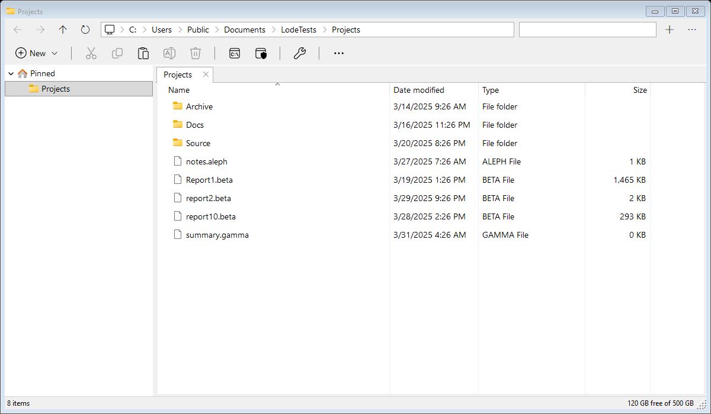


## Install

Lode ships as a [dotnet tool](https://learn.microsoft.com/en-us/dotnet/core/tools/global-tools), [Lode](https://www.nuget.org/packages/Lode). It needs the .NET Desktop Runtime 11 or later.

```
dotnet tool install -g Lode
```

## Run

```
lode
lode D:\Code
lode D:\Code\readme.md
```

Pass a folder to open it, or a file to open its folder with that file selected. With no arguments the tabs from last time are reopened. `lode --help` lists the switches.

From source: `dotnet run --project src/Lode`.

## Replacing File Explorer

```
lode --replace-explorer
lode --restore-explorer
```

The same two actions are buttons under **Options** in the ⋯ menu at the right of the address bar. Replacing makes Lode what opens folders and drives (double-clicks, folder shortcuts, other apps opening a folder) and what Win+E starts. Restoring undoes it, and puts back whichever app was the default for folders before.

 * It writes only to `HKEY_CURRENT_USER\Software\Classes`, so it applies to the current Windows account and needs no administrator rights.
 * Folders are pointed at the installed tool (`%USERPROFILE%\.dotnet\tools\lode.exe`) whenever it exists, even when Replace is clicked in a local build, so cleaning a build folder never breaks opening folders. Only without the tool is the running copy registered.
 * Explorer's own **Open** stays on every folder's right-click menu.
 * The taskbar's File Explorer button, and apps that start `explorer.exe` themselves or ask it to show a file selected, still open Explorer.
 * Run `lode --restore-explorer` before uninstalling the tool. Otherwise folders keep pointing at a Lode that is no longer there.

### Going back to File Explorer

Any one of these works:

 * In Lode, open **Options** from the ⋯ menu and click **Restore File Explorer**.
 * From a terminal, run `lode --restore-explorer`.
 * If Lode is already uninstalled, or will not start, remove its registry entries by hand:

   ```
   reg delete "HKCU\Software\Classes\Directory\shell\Lode" /f
   reg delete "HKCU\Software\Classes\Drive\shell\Lode" /f
   reg delete "HKCU\Software\Classes\Directory\shell" /ve /f
   reg delete "HKCU\Software\Classes\Drive\shell" /ve /f
   reg delete "HKCU\Software\Classes\CLSID\{52205fd8-5dfb-447d-801a-d0b52f2e83e1}" /f
   ```

   The first two remove the **Open in Lode** verb. The next two clear the default folder action, which Lode set to itself, so Explorer's **Open** takes over again. The last one removes Lode's Win+E command. Only delete that key if Lode added it: check that `HKCU\Software\Classes\CLSID\{52205fd8-5dfb-447d-801a-d0b52f2e83e1}\shell\opennewwindow` has a `CreatedBy` value of `Lode`. If another app was the default for folders before Lode, removing the entries by hand does not bring it back, unlike Restore. Its name is in the `LodePreviousDefault` value of the `Lode` key, so read that before deleting the key.

After restoring, folders open in Explorer straight away. If one still opens in Lode, sign out and back in, or restart Explorer from Task Manager.

## Publish

Pushing a tag builds and publishes that version: tag `1.2.3` (or `v1.2.3`) publishes 1.2.3 to nuget.org through [trusted publishing](https://learn.microsoft.com/en-us/nuget/nuget-org/trusted-publishing). The `publish` job in `.github/workflows/build.yml` needs a `nuget` environment on the repository and a trusted publishing policy on nuget.org for this repository and workflow.

## Build and test

Needs the .NET 11 SDK.

```
dotnet build src/Lode.slnx
dotnet test --solution src/Lode.slnx
```

Tests use [TUnit](https://github.com/thomhurst/TUnit) and [Verify](https://github.com/VerifyTests/Verify):

 * Text snapshots cover sorting, filtering, navigation history, the folder tree, settings, and copy, move and rename against a sample folder. They run in any configuration.
 * Image snapshots of the whole window ([Verify.WinForms](https://github.com/VerifyTests/Verify.WinForms)), the menus, the command palette and the Options dialog, which are also the pictures in this readme, run in Debug builds only, since pixels depend on the Windows version, theme and fonts of the machine that captured them. While they run they create a sample folder at `C:\Users\Public\Documents\LodeTests`, a path that is the same on every machine so it can appear in the address bar, and delete it afterwards.

## Features

 * Address bar that shows each folder up the path as a button, with chevrons between, as Explorer does, with This PC as an icon: click a folder to go there. The chevrons are only separators, without Explorer's drop-down lists. Click the empty space after the path, or press Ctrl+L, to type a path instead.
 * Actions bar under the address bar, with a button for any of the right-click menus' actions: New, Cut, Copy, Paste, Rename, Delete, Terminal, Terminal (admin) and Properties by default, each enabled when it applies to the selection, or to the folder when nothing is selected. Under **Actions** in Options, tick which actions show as buttons and which in the right-click menus (the list's, and the folder tree's). The rest are under **See more** (⋯) at the end of the bar, as in Explorer. Menu entries have icons too.

   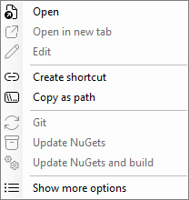

 * Tabs, each with its own back/forward history and a cross to close it. Right-click a tab to duplicate it, close it, close the others, those to its left or right, or all of them. **Reopen closed tab** (Ctrl+Shift+T) brings back the last tab closed in that window, at the folder it was showing.

   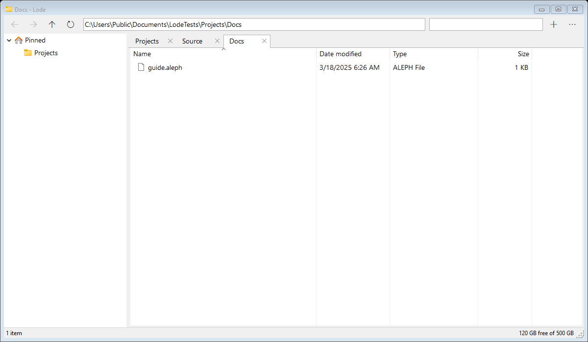

 * **Command palette** (Ctrl+Shift+P, or the ⋯ menu): type part of a command's name and press Enter. It lists the window's commands (navigation, tabs, hidden items, terminal, pinning, options) and whatever the right-click menu offers for the selection, or for the folder when nothing is selected.

   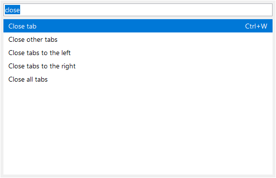

 * Drag a tab off the tab row to open it in a window of its own, or onto another Lode window to move it there, history and all.
 * Lives in the tray. Closing the last window hides it; click the tray icon (or launch Lode again) to bring it back, or Shift+click it for a new window, and choose **Exit** from the tray menu or the ⋯ menu to quit. The tray icon is put on the taskbar rather than in the overflow, unless you have moved it there yourself.
 * One copy per Windows account. Launching Lode again, including a folder opened from Explorer when Lode replaces it, hands the folders to the running copy, which opens them in a new window. All windows share that one process, so tabs can be dragged between any of them.
 * Folder tree with a **Pinned** section (folders pinned to Quick access in Explorer), a **Recent** section (folders Explorer adds to Quick access because you use them often), then the drives. It follows the active tab. To pin a folder, drag it (or a tab) onto the **Pinned** heading, or use **Pin to Quick access** in the ⋯ menu, which unpins too. Pins made in Explorer are read when Lode starts. Right-clicking a folder in the tree offers what a folder in the list gets: Open, Terminal, Cut, Copy, Paste into it, Rename, Delete, Create shortcut and so on. Drives can't be cut, renamed or deleted, and Pinned and Recent entries can't be renamed.
 * Details list with shell icons and type names, natural sort order, and click-to-sort columns. As in Explorer, there is a margin left of the list: drag from it to select the rows the rectangle covers (Ctrl+drag adds to the selection), or click it to clear the selection. Right-click the column headers to size a column, or all of them, to fit, or to hide or show Date modified, Type and Size, in every tab and window; Name always shows.

   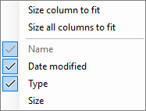

 * A short right-click menu that opens at once: Open, Terminal and Terminal (admin) (on a folder, or empty space), Cut, Copy, Rename, Delete, Create shortcut, Copy as path, Properties and so on. **Create shortcut** puts a `name - Shortcut.lnk` beside each selected item, as Explorer does. On empty space, **New** lists Folder and the file types Windows offers under New (Text Document and whatever installed apps add); the new item is ready to rename. **Show more options** at the bottom, or Shift+right-click, opens the classic Windows context menu, with installed shell extensions (7-Zip, Open with, and so on), less Send to, Include in library, Restore previous versions and Edit in Notepad.

   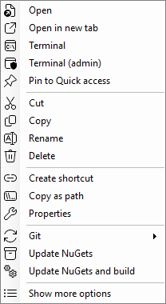 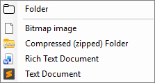

 * **Options** in the ⋯ menu: show hidden items (on by default; also Ctrl+H), show system files (off by default: Windows, Program Files, other people's folders under Users, and the files Windows protects, in the list and the folder tree), show the Recent section, the default folder new tabs open in, the text editor, the code folder, and replace or restore File Explorer.

   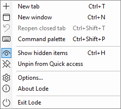 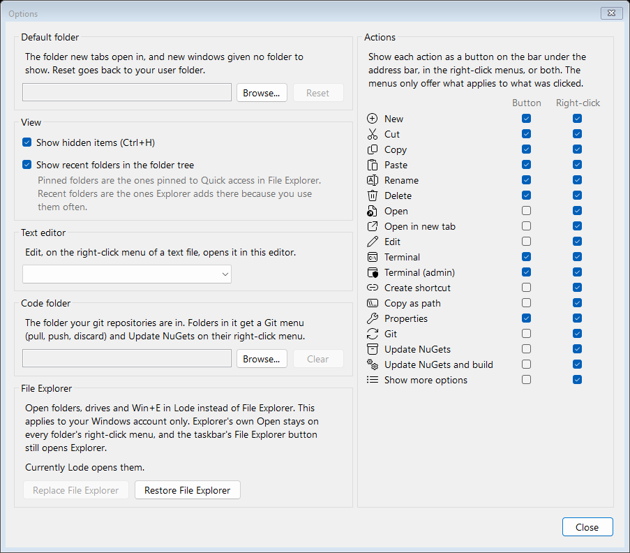

 * **Edit** on the right-click menu of text files opens them in the text editor chosen in Options. Installed editors (Visual Studio Code, Notepad++ and others) are found from the registry; Notepad is always there.
 * **Code folder**: choose the folder your git repositories are in. Folders in it get a **Git** submenu (Pull, Push, Discard, across every repository up to two levels down) and **Update NuGets** (optionally then building) on their right-click menu. Push and Discard ask first. Each runs in the background and shows in an **Actions** panel under the folder tree, with progress while it runs; click a line for everything it reported, right-click to remove lines.

   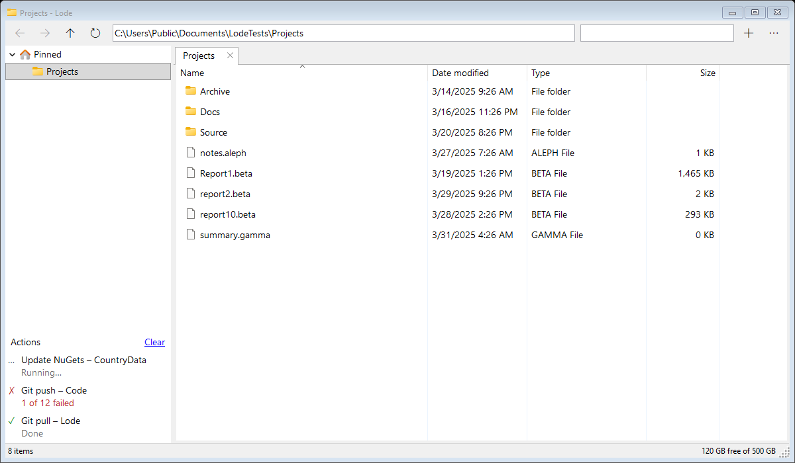

 * Copy, move, delete and rename go through the Windows shell (IFileOperation, as Explorer uses): standard progress dialog, conflict prompts, Recycle Bin and undo. Paths longer than 260 characters work.
 * Drag and drop to and from Explorer and other apps.
 * Filter box: type part of a name, or a wildcard such as `*.cs`.

   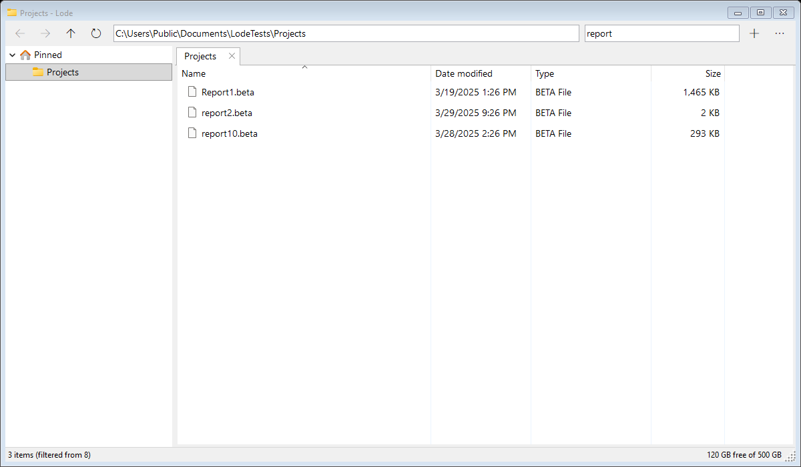

 * The list refreshes itself when the folder changes on disk.
 * Window size, open tabs and the options are remembered in `%AppData%\Lode\settings.json`. With several windows open, the last one closed is what the next start restores.

## Keyboard

| Keys                              | Action                        |
|-----------------------------------|-------------------------------|
| Alt+Left / Backspace, Alt+Right   | Back, forward                 |
| Alt+Up                            | Up one level                  |
| Ctrl+T, Ctrl+W                    | New tab, close tab            |
| Ctrl+Shift+T                      | Reopen closed tab             |
| Ctrl+Shift+P                      | Command palette               |
| Ctrl+Tab, Ctrl+Shift+Tab          | Next tab, previous tab        |
| Ctrl+L, Alt+D, F4                 | Address bar                   |
| Ctrl+F, F3                        | Filter box                    |
| F5                                | Refresh                       |
| F2                                | Rename                        |
| Delete, Shift+Delete              | Recycle, delete permanently   |
| Ctrl+C, Ctrl+X, Ctrl+V            | Copy, cut, paste              |
| Ctrl+Shift+N                      | New folder                    |
| Alt+Enter                         | Properties                    |
| Ctrl+H                            | Show or hide hidden items     |
| Ctrl+N                            | New window                    |

Click a tab's cross or middle-click the tab to close it. The mouse back and forward buttons work too.
